# 01 — Architecture logicielle

> **Projet :** Focus — application de gestion de tâches et de productivité
> **Nom de code technique :** `focus-all` (dossier de travail)
> **Statut du document :** v1.0 — référence d'architecture pour le développement
> **Public :** architectes, développeurs frontend/backend/mobile, DevOps, agents IA contributeurs
> **Documents liés :** [02-CAHIER-DES-CHARGES.md](./02-CAHIER-DES-CHARGES.md) · [03-DOCUMENTATION-TECHNIQUE.md](./03-DOCUMENTATION-TECHNIQUE.md) · [04-BEST-PRACTICES.md](./04-BEST-PRACTICES.md) · [05-SKILLS-AND-TOOLS.md](./05-SKILLS-AND-TOOLS.md)

---

## 1. Objet et périmètre

Ce document décrit l'architecture cible de **Focus**, une application multiplateforme de gestion de tâches et de productivité (Android, Web, Desktop Windows/macOS/Linux). Il couvre :

- l'organisation du monorepo et des dossiers ;
- les décisions d'architecture (ADR) et leur justification ;
- l'architecture frontend (Expo / React Native / React Native Web) ;
- l'architecture backend (NestJS) ;
- le modèle de données PostgreSQL + Prisma ;
- les conventions d'API REST ;
- le protocole de synchronisation et le mode hors ligne ;
- le temps réel et la collaboration ;
- l'infrastructure, la sécurité, la performance et l'évolutivité.

**Ce document ne contient aucune fonctionnalité implémentée.** Il décrit une cible. Toute affirmation contraire serait une erreur : à la date de rédaction, le dépôt ne contient aucun code applicatif (voir §2).

---

## 2. Analyse de l'existant (constat réel)

L'analyse a été menée avant toute rédaction, sans modification de fichier.

### 2.1 Contenu du dépôt

| Élément | Constat |
|---|---|
| Fichiers suivis | `.gitignore` uniquement (contenu : `.freebuff`) |
| Dossiers | `.git/`, `.freebuff/` |
| Historique Git | 1 commit (`first commit`), aucun tag, aucune branche de feature |
| Code source | **Aucun** — pas de `package.json`, pas de `tsconfig.json`, pas de `src/` |
| Tests | **Aucun** |
| CI/CD | **Aucune** configuration (pas de `.github/`, pas de `Dockerfile`) |
| Documentation | **Aucune** avant ce dossier `docs/` |
| Licence | Absente |

### 2.2 Environnement de développement constaté

| Élément | Valeur constatée | Incidence |
|---|---|---|
| OS de développement | Windows (shell Git Bash) | Les scripts npm doivent rester compatibles POSIX **et** Windows ; éviter `rm -rf` nu dans les scripts, privilégier `rimraf` ou des scripts Node |
| Node.js | v22.23.5 (nvm-windows 2.0.1, version `default`) | Version **LTS**, dans la plage `engines` `>=22.12 <23` — conformité établie le 2026-11-24 (voir ADR-016 et doc 03 §1.3.1) |
| npm | 11.11.0 | Suffisant, mais le projet cible **pnpm** (ADR-003) |
| Bun | absent | Non requis ; ne pas introduire de dépendance à Bun |
| Git | dépôt initialisé, `user.name` / `user.email` configurés | Prêt pour Conventional Commits (voir doc 04) |

### 2.3 Contraintes et conséquences

1. **Démarrage à blanc** : aucune dette technique existante, mais aucune fondation non plus (lint, tsconfig, CI, design system). Tout est à créer.
2. **Cible multiplateforme dès le MVP** : le choix de socle (Expo) est structurant et doit être validé avant la première ligne de code.
3. **Windows comme poste principal** : les builds macOS et iOS ne peuvent pas être produits localement → CI macOS obligatoire (EAS Build pour iOS, runner macOS pour Tauri).
4. **Aucun hébergement choisi** : l'architecture doit rester déployable sur un VPS unique (Docker Compose) comme sur un PaaS, sans dépendance à un fournisseur.

---

## 3. Principes d'architecture

| # | Principe | Traduction concrète |
|---|---|---|
| P1 | **Un domaine, un langage** | TypeScript de bout en bout ; les schémas Zod de `packages/contracts` sont la source de vérité des contrats API, partagés front/back |
| P2 | **Monolithe modulaire d'abord** | Un seul service NestJS organisé en modules à frontières nettes ; pas de microservices avant qu'un besoin de scalabilité réelle soit mesuré |
| P3 | **Offline comme état de première classe** | Le client ne suppose jamais le réseau disponible ; l'UI lit un cache local, les mutations passent par une file d'attente |
| P4 | **Le serveur est autoritaire** | Horodatages, versions, permissions et règles de récurrence sont calculés côté serveur ; le client propose, le serveur dispose |
| P5 | **UI partagée, présentation adaptative** | Logique et composants métier partagés ; la mise en page diverge par plateforme via des fichiers `.web.tsx` / `.native.tsx` et des points de rupture |
| P6 | **Sécurité par conception** | Cloisonnement par workspace appliqué au niveau requête (guard + repository), jamais au niveau UI |
| P7 | **Observabilité avant optimisation** | Logs structurés, traces, métriques dès le MVP ; toute optimisation doit être mesurée (doc 04, §performance) |
| P8 | **Documentation vivante** | Toute décision structurante devient un ADR ; les cinq documents de `docs/` évoluent avec le code dans la même PR |

---

## 4. Vue d'ensemble (C4)

### 4.1 Contexte système

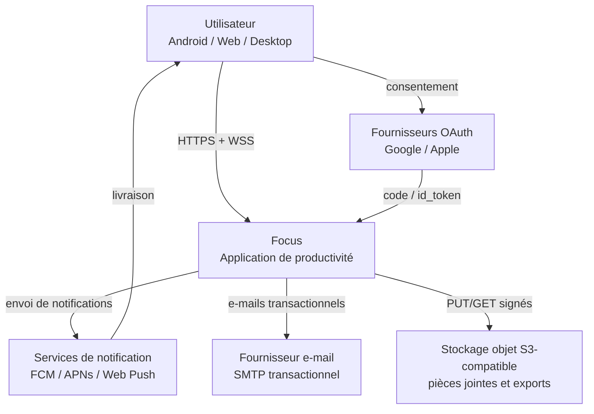

### 4.2 Conteneurs

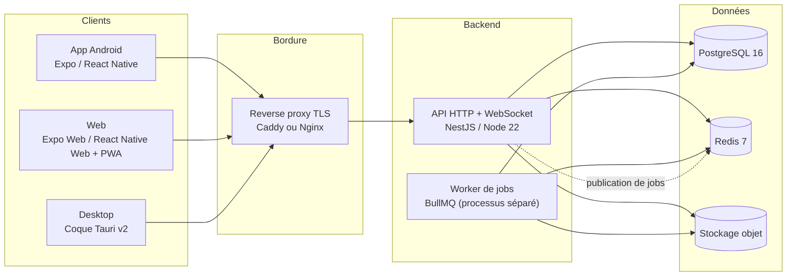

**Justification du découpage** : un seul domaine métier, une seule équipe au démarrage. L'API et le worker partagent le même code (`apps/api/src/worker.ts`) mais s'exécutent dans deux processus : une tâche de fond (envoi de rappels, recalcul de récurrences, purge) ne doit jamais bloquer une requête HTTP.

---

## 5. Décisions d'architecture (ADR)

Les ADR sont numérotés de manière stable et référencés par les quatre autres documents.

### ADR-001 — Monorepo pnpm + Turborepo

| | |
|---|---|
| **Statut** | Accepté |
| **Contexte** | Trois clients partagent types, schémas de validation, tokens de design et client API. Un dépôt multi-paquets évite la duplication et le drift de contrats. |
| **Options** | (a) dépôts séparés + publication npm privée ; (b) monorepo npm workspaces ; (c) monorepo **pnpm workspaces + Turborepo**. |
| **Décision** | (c). pnpm pour le `node_modules` non plat (indispensable avec React Native, qui casse avec les arbres aplatis), Turborepo pour le graphe de tâches et le cache local/CI. |
| **Conséquences** | (+) contrats partagés, refactors atomiques, un seul CI. (−) configuration Metro à adapter aux workspaces (`watchFolders`, `nodeModulesPaths`) ; courbe d'apprentissage pnpm. |
| **Alternatives écartées** | npm workspaces : hoisting problématique avec Expo. Dépôts séparés : surcoût de versionnage pour une équipe réduite. |

### ADR-002 — Expo (SDK récent) comme socle unique mobile + web

| | |
|---|---|
| **Statut** | Accepté |
| **Contexte** | Cible Android + Web + Desktop avec une petite équipe. |
| **Options** | (a) React Native CLI + RN Web ; (b) **Expo + Expo Router + React Native Web** ; (c) deux bases : React DOM (Vite) pour le web + React Native pour le mobile. |
| **Décision** | (b) pour le MVP. Expo fournit le prébuild Android, les modules natifs (notifications, SQLite, secure store, haptique), OTA updates via EAS Update et une cible web statique exportable. |
| **Conséquences** | (+) ~90 % du code UI/UX partagé, un seul modèle mental, builds Android automatisés (EAS). (−) le web hérite des limites de React Native Web : pas de HTML sémantique natif (accessibilité à construire), drag & drop DOM non trivial, bundle plus lourd qu'un site React classique. |
| **Mitigation** | Couche d'abstraction `packages/ui` sans import direct de `react-native` dans la logique métier ; primitives d'accessibilité (`accessible`, `accessibilityRole`, `aria-*` via RNW) centralisées ; fichiers `.web.tsx` pour les vues à forte densité (Kanban, calendrier). |
| **Porte de sortie** | Si, en fin de MVP, les budgets de performance web ou d'accessibilité WCAG 2.2 AA ne sont pas tenus (doc 02, RNF-05), migration du web vers une app React DOM (Vite) réutilisant `contracts`, `design-tokens` et la couche `data`. Cette porte est documentée, pas improvisée. |

### ADR-003 — Web : export statique Expo + PWA, pas de SSR au MVP

| | |
|---|---|
| **Statut** | Accepté |
| **Contexte** | L'application est authentifiée et personnelle : le SEO n'a aucune valeur, le rendu serveur n'apporte rien fonctionnellement. |
| **Décision** | `expo export --platform web` produit un bundle statique servi par CDN. Un `manifest.webmanifest` + service worker (Workbox) assurent l'installabilité et le cache applicatif (PWA). |
| **Conséquences** | (+) hébergement trivial et bon marché, démarrage rapide, offline du shell. (−) pas de partage de liens profonds server-rendered ; les notifications Web Push nécessitent HTTPS et un abonnement explicite. |

### ADR-004 — Desktop : PWA d'abord, coque Tauri v2 ensuite

| | |
|---|---|
| **Statut** | Accepté (décision en deux temps) |
| **Contexte** | Cible Windows, macOS, Linux. Options : Electron, Tauri v2, PWA installée. |
| **Options** | Electron : mature, ~100 Mo par app, empreinte mémoire élevée, mises à jour lourdes. Tauri : binaire < 10 Mo, utilise la WebView du système, nécessite Rust et un CI multi-OS. PWA : zéro packaging, mais pas d'autostart, pas de tray fiable, timers suspendus. |
| **Décision** | **Phase MVP :** PWA installable (ADR-003) — couvre la promesse « fonctionne sur Desktop » sans coût de packaging. **Phase V1.1 :** coque **Tauri v2** chargeant le même bundle web, pour les capacités natives : démarrage au login, icône de zone de notification, raccourcis globaux, notifications natives, minuteur Pomodoro en arrière-plan. |
| **Conséquences** | (+) un seul bundle web à maintenir, deux canaux de distribution. (−) matrice de WebView à tester (WebView2 sur Windows, WKWebView sur macOS, WebKitGTK sur Linux) ; signatures de code Windows/macOS nécessaires à la distribution. |
| **Alternatives écartées** | Electron : coût de distribution et empreinte injustifiés pour une app de productivité. |

### ADR-005 — Backend NestJS + Node.js 22 LTS

| | |
|---|---|
| **Statut** | Accepté |
| **Contexte** | Besoin de modules clairs, injection de dépendances, validation, WebSocket, jobs, tests — avec une équipe TypeScript. |
| **Options** | Express nu, Fastify nu, NestJS, tRPC, Go/Spring. |
| **Décision** | NestJS sur l'adaptateur Fastify (meilleures performances HTTP, validation via `nestjs-zod`). Pourquoi pas tRPC : le client React Native + un futur accès public/mobile hors monorepo rendent un contrat REST versionné plus durable ; de plus, les schémas Zod partagés donnent 80 % du bénéfice de tRPC sans coupler le transport. |
| **Conséquences** | (+) structure imposée, écosystème (BullMQ, Socket.IO, Swagger, Passport), testabilité. (−) verbosité, décorateurs, surface d'apprentissage. |

### ADR-006 — PostgreSQL 16 + Prisma

| | |
|---|---|
| **Statut** | Accepté |
| **Contexte** | Données fortement relationnelles (workspaces, projets, tâches, tags, récurrences) + besoin de requêtes analytiques pour les statistiques. |
| **Décision** | PostgreSQL 16 (JSONB pour les métadonnées et les payloads de synchronisation, `tstzrange`-ready pour le suivi de temps) et Prisma ORM avec migrations versionnées. |
| **Conséquences** | (+) typage généré, migrations lisibles, `$transaction` interactive. (−) Prisma ne couvre pas tout SQL avancé : les requêtes analytiques passeront par `$queryRaw` typé, isolées dans des repositories dédiés. |
| **Règles** | Tout accès aux données passe par un repository de module ; aucun `PrismaService` injecté directement dans un controller. |

### ADR-007 — Séparation stricte Zustand / TanStack Query

| | |
|---|---|
| **Statut** | Accepté |
| **Décision** | **TanStack Query** = état serveur (cache, invalidation, retry, pagination, mutations optimistes). **Zustand** = état client pur (session en mémoire, filtres et préférences d'UI, minuteur Pomodoro, file d'attente d'affichage, mode de sélection). Un store Zustand ne stocke **jamais** une entité serveur dupliquée. |
| **Conséquences** | (+) pas de double source de vérité, pas de bugs de désynchronisation. (−) discipline nécessaire en revue de code (règle vérifiée, doc 04 §état). |

### ADR-008 — Axios encapsulé, jamais utilisé directement dans un composant

| | |
|---|---|
| **Statut** | Accepté |
| **Décision** | Un client Axios unique (`packages/contracts/src/http` ou `apps/*/src/data/http`) configure `baseURL`, `timeout`, `Accept-Language`, l'en-tête `X-Client-Version` et les intercepteurs : injection du jeton d'accès, **rafraîchissement avec file d'attente** (une seule requête de refresh pour N requêtes 401 concurrentes), normalisation des erreurs en `AppError`, corrélation `X-Request-Id`. |
| **Justification vs fetch** | Intercepteurs matures, annulation via `AbortSignal`, progression d'upload (pièces jointes), comportement homogène RN/Web. |
| **Conséquences** | (−) ~14 ko gzip ; jugé acceptable face au gain de robustesse. |

### ADR-009 — Contrats partagés : Zod + types inférés

| | |
|---|---|
| **Statut** | Accepté |
| **Décision** | `packages/contracts` expose, par ressource : schémas Zod de requête/réponse, types `z.infer`, constantes d'énumération et codes d'erreur. Le backend valide avec les **mêmes** schémas (`nestjs-zod`), le client type ses appels avec les mêmes types. |
| **Conséquences** | (+) une seule vérité, erreurs de contrat détectées à la compilation. (−) toute évolution de contrat impacte les trois clients → versionnement d'API obligatoire (ADR-013). |

### ADR-010 — Authentification : JWT courte durée + refresh rotatif

| | |
|---|---|
| **Statut** | Accepté |
| **Décision** | Access token JWT (15 min, en **mémoire** uniquement), refresh token opaque rotatif (30 jours, **haché** en base, lié à un appareil, réutilisation détectée → révocation de toute la famille). Web : refresh en cookie `HttpOnly; Secure; SameSite=Strict`. Mobile/Desktop : refresh dans `expo-secure-store` / coffre natif. |
| **Conséquences** | (+) vol de refresh détecté, pas de jeton longue durée dans le stockage scriptable. (−) complexité de l'intercepteur et gestion multi-appareils (table `Session`). Voir doc 03 §authentification. |

### ADR-011 — Synchronisation : journal de changements + curseur, résolution LWW par champ

| | |
|---|---|
| **Statut** | Accepté |
| **Contexte** | Mode hors ligne et multi-appareils exigent un protocole de convergence simple, testable et peu coûteux. |
| **Options** | (a) rechargement complet périodique ; (b) CRDT (Yjs/Automerge) ; (c) **journal de changements append-only + curseur + versions optimistes**. |
| **Décision** | (c). Chaque écriture serveur incrémente `version` sur l'entité et insère une ligne dans `SyncChange`. Le client pousse ses mutations en lot avec `clientMutationId` (idempotence) et `baseVersion` (verrou optimiste) ; le serveur répond item par item (`applied`, `conflict`, `rejected`). Conflit sur champs scalaires → dernier écrivain gagnant **par champ** ; conflit sur texte long (description, note) → conservation des deux versions et résolution manuelle proposée dans l'UI. |
| **Justification** | Les CRDT sont surdimensionnés : le contenu riche collaboratif temps réel n'est pas au programme du MVP (doc 02). Le journal est auditable, reprenable et simple à déboguer. |
| **Conséquences** | (−) nécessite une purge du journal et une stratégie de resynchronisation complète (`410 Gone`). Voir §10. |

### ADR-012 — Temps réel : WebSocket Socket.IO, adaptateur Redis

| | |
|---|---|
| **Statut** | Accepté (V1.3 pour la collaboration) |
| **Décision** | Gateway NestJS `@nestjs/websockets` + Socket.IO, authentifiée par le même JWT en handshake, rooms par workspace et par projet. Adaptateur Redis pour le multi-instance. Repli sur polling TanStack Query si le WebSocket échoue. |
| **Conséquences** | (−) Socket.IO ajoute un protocole propre (non standard) : acceptable car aucun client tiers n'est prévu. |

### ADR-013 — API REST versionnée `/api/v1`, erreurs RFC 9457

| | |
|---|---|
| **Statut** | Accepté |
| **Décision** | REST, ressources au pluriel, pagination par curseur, tri explicite, erreurs `application/problem+json`, `Idempotency-Key` sur les mutations critiques, versionnement par préfixe d'URL. JSON en `camelCase`. |
| **Conséquences** | (+) interopérable, cachable, documenté par OpenAPI généré. (−) plusieurs allers-retours pour les agrégats → compensé par des endpoints de lecture dédiés (`/today`, `/stats/*`) et le protocole de sync. |

### ADR-014 — Fichiers : S3-compatible, upload présigné

| | |
|---|---|
| **Statut** | Accepté |
| **Décision** | Stockage objet compatible S3 (MinIO en local, R2/S3 en production). Le client demande une URL présignée, upload directement, puis confirme ; l'API ne proxifie jamais les octets. Limites : 10 Mo par pièce jointe, types autorisés en liste blanche. |
| **Conséquences** | (+) API légère, coût maîtrisé. (−) validation post-upload obligatoire (type MIME réel, antivirus en file de jobs avant exposition). |

### ADR-015 — Jobs asynchrones : BullMQ + Redis

| | |
|---|---|
| **Statut** | Accepté |
| **Contexte** | Rappels planifiés, envoi de push, recalcul de récurrences, exports, purge, e-mails. |
| **Décision** | BullMQ avec files nommées (`reminders`, `notifications`, `recurrence`, `maintenance`, `exports`), jobs idempotents, `jobId` déterministe, tentatives exponentielles (5 max), DLQ inspectable. |
| **Conséquences** | (+) fiabilité et visibilité. (−) Redis devient un composant critique → supervision obligatoire. |

### ADR-016 — Versions et outillage : Node 22 LTS, TypeScript strict

| | |
|---|---|
| **Statut** | Accepté |
| **Décision** | Node **22 LTS** épinglé (`engines`, `.nvmrc`, image Docker `node:22-alpine`), pnpm 9, TypeScript 5.x en `strict` + `noUncheckedIndexedAccess`. Le poste de développement est **réaligné** (2026-11-24) sur Node **22.23.5** via nvm-windows 2.0.1, avec pnpm 9.15.9 fourni par Corepack ; Node 25 n'est pas supporté par les versions LTS d'Expo/Nest. |
| **Conséquences** | (−) contrainte pour les contributeurs, automatisée par `engines` + `corepack`. (+) réalignement vérifié : avec `engine-strict=true` actif, `pnpm install`, `pnpm typecheck`, `pnpm lint`, `pnpm test` et `pnpm build:web` sortent en code `0` sous Node 22.23.5. |

### ADR-017 — Identifiants et horodatages

| | |
|---|---|
| **Statut** | Accepté |
| **Décision** | Clés primaires **UUID v7** (ordonnables dans le temps, générées côté serveur pour les entités métier ; côté client pour les créations hors ligne, afin d'éviter les doublons à la réconciliation). Horodatages en `timestamptz` UTC ; les dates « civiles » (échéance, jour d'habitude) sont stockées en `date` **avec** le fuseau de l'utilisateur (`timezone` IANA) pour éviter les décalages de jour. |
| **Conséquences** | (−) UUID plus volumineux qu'un `bigint` : acceptable à cette échelle ; (+) fusion hors ligne naturelle. |

### ADR-018 — Internationalisation dès le MVP

| | |
|---|---|
| **Statut** | Accepté |
| **Décision** | `i18next` + `react-i18next` côté clients, catalogues JSON versionnés (`fr` par défaut, `en`), formats de date via `Intl` (jamais de formatage manuel), validation des messages d'erreur par code et non par texte. |
| **Conséquences** | (+) aucune string en dur, testable, extensible. (−) discipline : chaque nouvelle clé doit être ajoutée aux deux catalogues (vérifié en CI). |

### ADR-019 — Observabilité : logs structurés, traces OpenTelemetry, erreurs Sentry

| | |
|---|---|
| **Statut** | Accepté |
| **Décision** | `pino` (JSON, `requestId`, `userId`, `workspaceId`), OpenTelemetry pour HTTP/Prisma/BullMQ, Sentry pour les erreurs clients et serveur avec `release` = SHA de commit et `traceId` propagé. |
| **Conséquences** | (−) surcoût de configuration initiale ; (+) diagnostic possible dès les premiers incidents. |

### ADR-020 — Pas de microservices, pas de GraphQL au MVP

| | |
|---|---|
| **Statut** | Accepté |
| **Décision** | Le monolithe modulaire couvre le besoin. GraphQL est écarté : le client est propriétaire, les écrans sont connus à l'avance, le protocole de sync est un endpoint dédié — GraphQL ajouterait de la complexité de cache sans bénéfice mesurable. |

---

## 6. Organisation du monorepo

### 6.1 Arborescence cible

```text
focus-all/
├─ apps/
│  ├─ api/                        # NestJS — API HTTP + WebSocket + worker
│  │  ├─ src/
│  │  │  ├─ main.ts               # bootstrap HTTP
│  │  │  ├─ worker.ts             # bootstrap worker BullMQ
│  │  │  ├─ app.module.ts
│  │  │  ├─ common/               # guards, interceptors, filters, decorators, pipes
│  │  │  ├─ config/               # configuration typée + validation d'env
│  │  │  ├─ modules/
│  │  │  │  ├─ auth/
│  │  │  │  ├─ users/
│  │  │  │  ├─ workspaces/
│  │  │  │  ├─ projects/
│  │  │  │  ├─ tasks/
│  │  │  │  ├─ tags/
│  │  │  │  ├─ reminders/
│  │  │  │  ├─ recurrence/
│  │  │  │  ├─ habits/            # V1.2
│  │  │  │  ├─ time-tracking/     # V1.2
│  │  │  │  ├─ focus-sessions/    # V1.1 (Pomodoro)
│  │  │  │  ├─ stats/             # V1.1
│  │  │  │  ├─ sync/
│  │  │  │  ├─ notifications/
│  │  │  │  ├─ attachments/
│  │  │  │  └─ realtime/          # gateway (V1.3)
│  │  │  ├─ jobs/                 # processors BullMQ
│  │  │  └─ database/             # PrismaService, repositories de base, seeds
│  │  ├─ prisma/
│  │  │  ├─ schema.prisma
│  │  │  ├─ migrations/
│  │  │  └─ seed.ts
│  │  └─ test/                    # e2e, fixtures, helpers
│  ├─ mobile/                     # Expo — Android + Web
│  │  ├─ app/                     # routes Expo Router (file-based)
│  │  ├─ src/
│  │  │  ├─ features/             # par domaine : tasks, projects, calendar, ...
│  │  │  ├─ components/           # composants d'écran (non réutilisables ailleurs)
│  │  │  ├─ data/                 # client HTTP, queries TanStack, repositories locaux
│  │  │  ├─ stores/               # stores Zustand
│  │  │  ├─ db/                   # SQLite (expo-sqlite), migrations locales, outbox
│  │  │  ├─ sync/                 # moteur de synchronisation
│  │  │  ├─ i18n/
│  │  │  └─ theme/
│  │  ├─ assets/
│  │  ├─ app.config.ts
│  │  └─ web/                     # service worker, manifest, icons PWA
│  └─ desktop/                    # Tauri v2 (V1.1)
│     ├─ src-tauri/
│     │  ├─ Cargo.toml
│     │  ├─ tauri.conf.json
│     │  └─ src/                  # commandes Rust : autostart, tray, notifications
│     └─ README.md
├─ packages/
│  ├─ contracts/                  # Zod + types + constantes + codes d'erreur
│  │  └─ src/{schemas,types,constants,http,index}.ts
│  ├─ ui/                         # design system React Native (web + native)
│  │  └─ src/{primitives,patterns,icons}/
│  ├─ design-tokens/              # couleurs, espacements, typographie, motion
│  │  └─ src/{tokens.ts,theme.ts}
│  └─ config/                     # eslint, tsconfig, prettier, tailwind (web)
│     └─ {eslint-preset.js,tsconfig.base.json,tsconfig.node.json,tsconfig.react.json}
├─ docs/                          # ces cinq documents
├─ docker/                        # compose local, Dockerfiles, init scripts
├─ .github/workflows/             # CI/CD (ci.yml : install, typecheck, lint, test, dérive OpenAPI, export web)
├─ turbo.json
├─ pnpm-workspace.yaml
├─ package.json
└─ .env.example
```

**État de cette arborescence (2026-11-26, M0 terminé, M1 en cours).** Réalisés : `src/common/` (filtre `problem+json`, `DomainError`, UUID v7), `src/config/` (schéma Zod d'environnement, chargement `.env`, module de configuration, application du préfixe et de CORS), `src/database/` (`PrismaService`, module global), `prisma/` (schéma, migrations initiale et projets, seed), `src/modules/{auth,health,projects,tasks,sync}` et `test/` (harnais d'intégration HTTP sur vraie base, exécution des migrations, tests d'auth, de projets et de convergence). Restent à créer avec leurs dépendances : `src/jobs/` et `worker.ts` (BullMQ/Redis), la suite e2e sous `test/` (fixtures, scénarios Playwright/Maestro), `apps/desktop/` (V1.1). Les paquets `ui` et `design-tokens` existent et sont consommés en source par Metro. Côté mobile, `src/data/` (client HTTP Axios typé par les contrats, session sécurisée, repositories tâches et projets), `src/features/{auth,tasks,projects}/` (connexion/inscription, liste et édition des tâches, projets) et `src/i18n/` (catalogues `fr`/`en`) existent ; SQLite, l'outbox et le reste des vues M1 restent à faire.

### 6.2 Règles de dépendance entre paquets

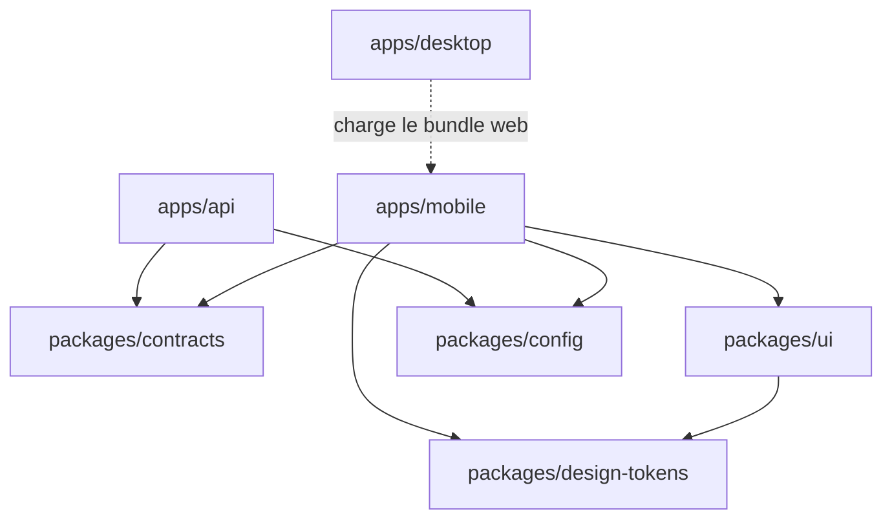

| Règle | Détail |
|---|---|
| R1 | `packages/*` ne dépend **jamais** d'un `apps/*`. |
| R2 | `contracts` n'a **aucune** dépendance runtime lourde (Zod uniquement) et aucun import de `react` ou `react-native`. |
| R3 | `ui` ne connaît **aucune** feature métier : uniquement des primitives et des patterns génériques. |
| R4 | Un module NestJS ne peut importer que `common/`, `config/`, `database/` et les modules dont il dépend explicitement — jamais un controller d'un autre module. |
| R5 | Les accès base de données sont interdits hors `database/` et des repositories de module. |

### 6.3 Scripts racine (contrat d'outillage)

| Script | Effet |
|---|---|
| `pnpm dev` | `turbo run dev` — API (4000) + Expo (8081) en parallèle |
| `pnpm dev:api` / `pnpm dev:app` | Démarrage ciblé |
| `pnpm build` | Build de tous les paquets et apps |
| `pnpm lint` / `pnpm typecheck` / `pnpm test` | Vérifications transverses |
| `pnpm db:migrate` / `pnpm db:seed` / `pnpm db:reset` | Prisma migrates / seed / reset local — **avec Prisma (M1)**, absents tant que la cible n'existe pas |
| `pnpm api:openapi` / `pnpm api:openapi:check` | Génère `openapi.json` depuis les schémas Zod / échoue si le fichier commité a dérivé |
| `pnpm docker:up` / `pnpm docker:down` | Services locaux (Postgres, Redis, MinIO, MailHog) |

Détail d'installation et d'exécution : **doc 03**.

---

## 7. Architecture frontend

### 7.1 Choix de navigation : Expo Router

Navigation par fichiers (`app/`) avec routes typées (`experiments.typedRoutes`), layouts imbriqués et deep links universels. Bénéfices : URLs web réelles (`/projects/:id`, `/calendar`), deep links Android (`focus://task/:id`), un seul modèle pour trois plateformes.

### 7.2 Carte de navigation (MVP)

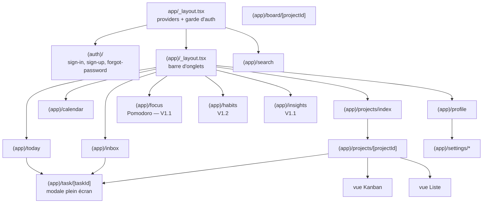

**Écarts assumés par plateforme**

| Plateforme | Navigation principale | Adaptations |
|---|---|---|
| Android | Onglets inférieurs + FAB de création | Gestes de swipe (compléter / reporter), notifications locales, retour matériel |
| Web | Barre latérale persistante + colonne de détail | Raccourcis clavier complets, multi-colonnes, glisser-déposer HTML5 |
| Desktop (Tauri) | Identique au web | Raccourci global d'ouverture rapide, tray, autostart |

### 7.3 Couches du client

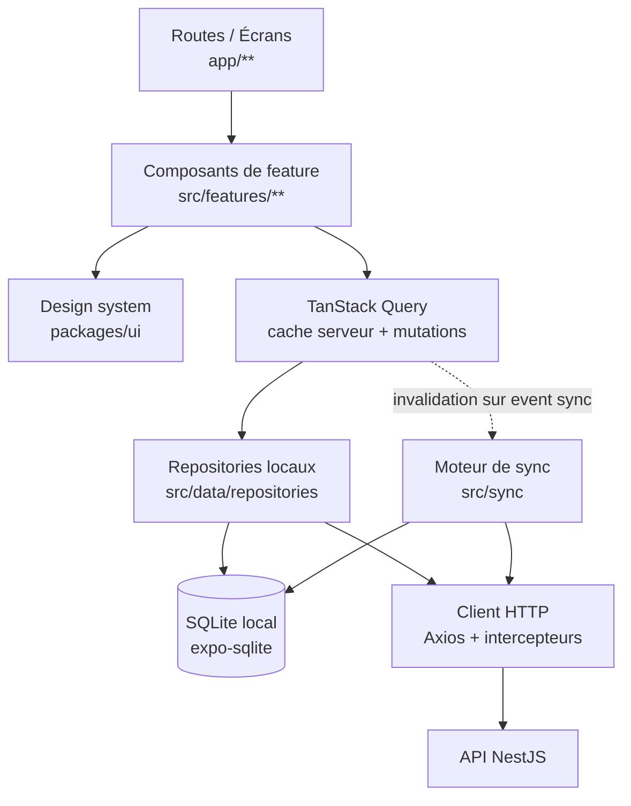

**Règle fondamentale** : les écrans ne parlent **jamais** à Axios. Ils consomment des hooks TanStack Query, lesquels s'appuient sur des repositories qui écrivent d'abord en local (SQLite) et alimentent l'outbox. Cela rend le mode hors ligne structurel plutôt qu'ajouté après coup.

### 7.4 Architecture d'état

| Nature de l'état | Outil | Exemples | Persistance |
|---|---|---|---|
| Serveur (entités) | TanStack Query | tâches, projets, tags, statistiques | cache mémoire + SQLite (miroir) |
| Session | Zustand (non persisté) | access token, profil courant | mémoire uniquement |
| Préférences UI | Zustand + `persist` (AsyncStorage) | thème, densité, vue par défaut, filtres épinglés | stockage local |
| Minuteur | Zustand + horodatage absolu | Pomodoro en cours, phase, cycles | AsyncStorage (reprise après kill) |
| Formulaire | React Hook Form + Zod | création/édition de tâche | mémoire |
| File d'écriture | Outbox SQLite | mutations en attente | SQLite |

**Point d'attention Pomodoro** : ne jamais stocker un `setInterval` comme source de vérité. On stocke `startedAt` + `durationMs` + `phase` ; le temps restant est recalculé à l'affichage. Cela survit à la suspension de l'app et aux changements d'heure.

### 7.5 Design system et identité visuelle

L'identité doit être originale — aucun emprunt aux codes visuels de TickTick. Proposition initiale (à valider par le design) :

| Token | Valeur | Usage |
|---|---|---|
| `color.bg.canvas` | `#0B0F14` (sombre) / `#F7F7F5` (clair) | fond applicatif |
| `color.bg.surface` | `#121821` / `#FFFFFF` | cartes, panneaux |
| `color.accent` | `#E8A33D` (ambre) | action primaire, focus visible |
| `color.accent.alt` | `#4F8DF7` | sélection, liens |
| `color.state.success` | `#3FB984` | tâche terminée |
| `color.state.danger` | `#E05C5C` | suppression, retard |
| `color.priority.urgent` | `#F0553C` | priorité urgente |
| `radius.sm / md / lg` | `6 / 12 / 20` | cohérence des surfaces |
| `space` | échelle 4 px (4→64) | grille 8 px effective |
| Typographie | Inter (UI) + Georgia-like pour les titres de projet ? → **Inter Display** pour les titres, **Inter** pour le texte | lisibilité dense |
| `motion.fast / base` | `120 ms / 220 ms`, `ease-out` | micro-interactions |

Le langage visuel retenu : **« papier calme »** — surfaces mates, bordures très fines (1 px, 8 % d'opacité), aucune ombre portée lourde, un seul accent coloré par écran, densité d'information élevée mais respiration verticale généreuse. Détail des règles UI/UX : doc 04 §UI/UX.

Les tokens vivent dans `packages/design-tokens/src/tokens.ts` et sont consommés par `packages/ui`. Aucune couleur littérale dans un composant.

### 7.6 Découpage par plateforme

| Mécanisme | Quand l'utiliser |
|---|---|
| `.web.tsx` / `.native.tsx` | Comportement réellement différent (drag & drop, hover, clavier, scroll) |
| `Platform.select` | Variation de style ou de constante mineure |
| Prop `platform` du hook `usePlatform()` | Rendu structurellement différent (nombre de colonnes) |
| Point de rupture `useBreakpoint()` | `compact` < 768 px, `medium` 768–1279 px, `expanded` ≥ 1280 px |

Interdit : dupliquer un écran entier pour le web. Si un écran diverge à plus de 50 %, c'est un signal de conception à revoir.

### 7.7 Performance frontend

- Listes longues : `FlashList` (Shopify) plutôt que `FlatList` ; virtualisation obligatoire au-delà de 50 éléments.
- Images : `expo-image` avec cache disque et `blurhash`.
- Bundle : analyse via `expo export --analyze` ; budget 400 ko gzip pour le shell web initial, écrans secondaires en `lazy`.
- Démarrage : objectif < 1,8 s « interactive » sur un Android milieu de gamme (doc 02, RNF-01).

---

## 8. Architecture backend

### 8.1 Anatomie d'un module

Chaque module NestJS suit la même structure :

```text
modules/tasks/
├─ tasks.module.ts
├─ tasks.controller.ts          # HTTP : validation, autorisation, mapping
├─ tasks.service.ts             # cas d'usage, transactions, règles métier
├─ tasks.repository.ts          # accès Prisma, scoping workspace
├─ dto/                         # schémas Zod réexportés depuis @focus/contracts
├─ policies/                    # règles d'autorisation pures et testables
├─ events/                      # événements de domaine internes
└─ __tests__/                   # unitaires + intégration
```

### 8.2 Chaîne de traitement d'une requête

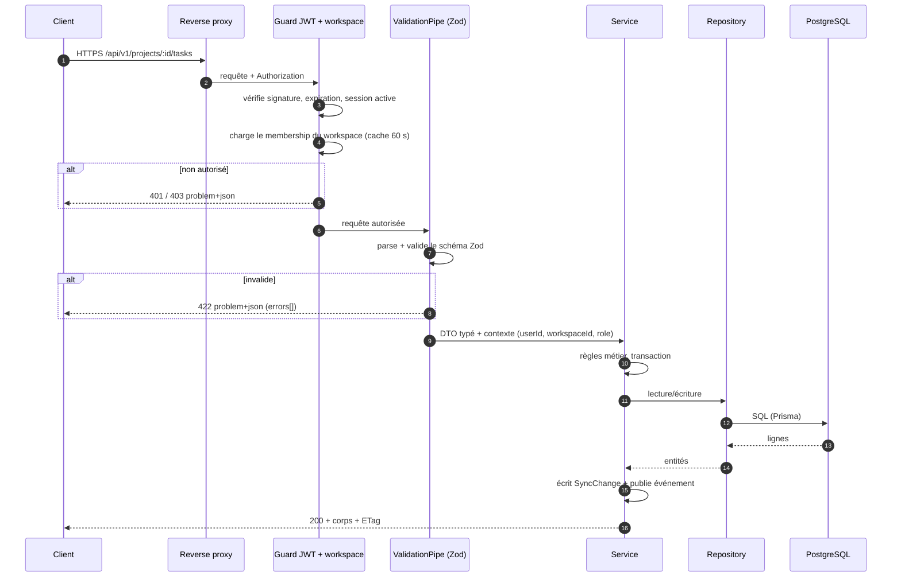

### 8.3 Éléments transverses

| Élément | Rôle |
|---|---|
| `JwtAuthGuard` | Valide l'access token, vérifie `sessionId` actif, injecte `AuthContext` |
| `WorkspaceGuard` | Vérifie l'appartenance au workspace ciblé et le rôle minimal requis |
| `ZodValidationPipe` | Validation et transformation des entrées ; erreurs détaillées par chemin |
| `ProblemDetailsFilter` | Convertit toute exception en `application/problem+json` |
| `RequestIdInterceptor` | Génère/propage `X-Request-Id`, l'injecte dans le logger |
| `IdempotencyInterceptor` | Mémorise la réponse par `Idempotency-Key` (Redis, 24 h) |
| `AuditInterceptor` | Journalise les mutations sensibles (partage, suppression, export) |
| `RateLimitGuard` | Quotas par IP et par utilisateur (`@nestjs/throttler`) |

### 8.4 Modules et responsabilités

| Module | Responsabilité | Phase |
|---|---|---|
| `auth` | inscription, connexion, refresh, déconnexion, réinitialisation, OAuth | MVP |
| `users` | profil, préférences, fuseau horaire, suppression de compte | MVP |
| `workspaces` | espace personnel, invitations, rôles | MVP (mono-utilisateur) / V1.3 (partage) |
| `projects` | projets, sections, ordre, archivage | MVP |
| `tasks` | tâches, sous-tâches, statuts, priorités, échéances, récurrence (pose) | MVP |
| `tags` | étiquettes et associations | MVP |
| `reminders` | rappels absolus/relatifs, planification des jobs | MVP |
| `recurrence` | expansion RRULE, calcul de la prochaine occurrence | MVP (basique) |
| `sync` | pull/push, journal, résolution de conflits | MVP |
| `notifications` | appareils, abonnements push, préférences | MVP (Android) / V1.1 (Web, Desktop) |
| `attachments` | URLs présignées, métadonnées, quotas | V1.1 |
| `focus-sessions` | Pomodoro, sessions, statistiques associées | V1.1 |
| `stats` | agrégats de productivité | V1.1 |
| `habits` | habitudes, entrées quotidiennes, séries | V1.2 |
| `time-tracking` | chronomètres et entrées manuelles | V1.2 |
| `realtime` | gateway Socket.IO, présence | V1.3 |
| `search` | recherche plein texte (Postgres FTS) | MVP (simple) / V1.3 (avancée) |

---

## 9. Modèle de données

### 9.1 Diagramme entité-association (périmètre MVP + extensions)

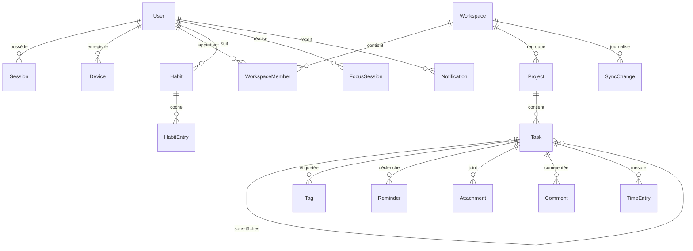

### 9.2 Tables principales

| Table | Colonnes clés | Notes |
|---|---|---|
| `User` | `id` (uuid v7), `email` (unique, `citext`), `passwordHash`, `displayName`, `avatarUrl`, `timezone` (IANA), `locale`, `emailVerifiedAt`, `createdAt`, `updatedAt`, `deletedAt` | `passwordHash` en Argon2id |
| `Session` | `id`, `userId`, `refreshTokenHash`, `familyId`, `deviceId`, `userAgent`, `ip`, `expiresAt`, `revokedAt`, `lastUsedAt` | rotation + détection de réutilisation |
| `Device` | `id`, `userId`, `platform` (`ANDROID`/`WEB`/`DESKTOP`), `pushToken`, `appVersion`, `lastSeenAt` | un token push par appareil |
| `Workspace` | `id`, `name`, `ownerId`, `isPersonal`, `createdAt` | un workspace personnel créé à l'inscription |
| `WorkspaceMember` | `workspaceId`, `userId`, `role` (`OWNER`/`ADMIN`/`MEMBER`/`VIEWER`), `joinedAt` | clé composite |
| `Project` | `id`, `workspaceId`, `name`, `color`, `icon`, `description`, `sortOrder`, `archivedAt`, `version`, `deletedAt`, `visibility` (`PRIVATE`/`WORKSPACE`) | `sortOrder` fractionnaire, `version` optimiste et soft delete ; unicité `(workspaceId, lower(name))` partielle sur les projets vivants (index d'expression SQL) |
| `Task` | `id`, `workspaceId`, `projectId` (nullable = Inbox), `parentId`, `title`, `description`, `status`, `priority`, `dueDate` (date), `dueTime`, `startDate`, `timezone`, `completedAt`, `sortOrder`, `recurrenceRule`, `recurrenceMode`, `estimateMinutes`, `tagIds` (`uuid[]`), `reminders` (`text[]` ISO), `searchVector` (colonne générée), `version`, `createdBy`, `updatedBy`, `deletedAt` | auto-référence pour les sous-tâches (max 50) ; `searchVector` + index GIN pour la recherche sans accents |
| `Tag` | `id`, `workspaceId`, `name`, `nameNormalized`, `color` | unicité `(workspaceId, nameNormalized)` ; la suppression retire l'id de `Task.tagIds` |
| `TaskTag` / `Reminder` | — | non utilisés en M1 : les tags vivent dans `Task.tagIds` et les rappels dans `Task.reminders` ; leur normalisation est une cible V1.1 |
| `Attachment` | `id`, `taskId`, `storageKey`, `fileName`, `mimeType`, `sizeBytes`, `checksum`, `uploadedBy`, `scanStatus` | `storageKey` jamais exposé tel quel |
| `Comment` | `id`, `taskId`, `authorId`, `body`, `createdAt`, `editedAt` | V1.3 |
| `Habit` | `id`, `userId`, `workspaceId`, `name`, `icon`, `frequency` (JSONB : jours ciblés), `targetPerPeriod`, `archivedAt` | V1.2 |
| `HabitEntry` | `id`, `habitId`, `date` (`date`), `value` (numeric), `note` | unicité `(habitId, date)` |
| `TimeEntry` | `id`, `taskId`, `userId`, `startedAt`, `endedAt`, `durationSeconds`, `source` (`TIMER`/`MANUAL`/`POMODORO`) | V1.2 |
| `FocusSession` | `id`, `userId`, `taskId`, `phase` (`FOCUS`/`SHORT_BREAK`/`LONG_BREAK`), `plannedSeconds`, `actualSeconds`, `startedAt`, `endedAt`, `completed` | V1.1 |
| `Notification` | `id`, `userId`, `type`, `payload` (JSONB), `readAt`, `createdAt` | centre de notifications |
| `SyncChange` | `id` (`bigserial`), `workspaceId`, `entityType`, `entityId`, `operation` (`UPSERT`/`DELETE`), `version`, `payload` (JSONB), `actorId`, `changedAt` | index `(workspaceId, id)` |
| `AuditLog` | `id`, `workspaceId`, `actorId`, `action`, `targetType`, `targetId`, `metadata` (JSONB), `createdAt` | conservation 12 mois |

### 9.3 Conventions de modélisation

| Convention | Règle |
|---|---|
| Suppression | **Soft delete** (`deletedAt`) sur `Task` et `Project` ; purge définitive après **30 jours** par le job quotidien `TrashPurgeWorker` (au démarrage puis toutes les 24 h), avec `pnpm --filter @focus/api db:purge` comme repli pour un ordonnanceur externe. Le soft delete produit un `SyncChange` de type `DELETE` (tombstone). |
| Ordre | `sortOrder numeric` (pas `integer`) : insertion entre deux éléments = moyenne des voisins ; renormalisation périodique par job. |
| Multi-tenant | Toute table métier porte `workspaceId` (dénormalisé même quand `projectId` suffirait) pour permettre les index et les requêtes de sync par workspace |
| Index | `(workspaceId, deletedAt)`, `(workspaceId, projectId, status, sortOrder)`, `(workspaceId, dueDate)`, GIN sur `searchVector` alimenté par `focus_unaccent(title || ' ' || coalesce(description,''))` |
| Timestamps | `createdAt` / `updatedAt` en `timestamptz` ; `updatedAt` mis à jour par Prisma (`@updatedAt`) — jamais par le client |
| Version | `version int` incrémenté à chaque écriture serveur (verrou optimiste) |
| Récurrence | `recurrenceRule` stocke une chaîne **RRULE RFC 5545** (ex. `FREQ=WEEKLY;BYDAY=MO,WE;INTERVAL=1`), `recurrenceMode` ∈ `FIXED` (même horaire) / `AFTER_COMPLETION` (intervalle depuis la complétion). Une série génère au plus **500** occurrences à la demande, sans rattrapage en cascade. |

### 9.4 Choix de modélisation à valider

- **Sections de projet** : reportées en V1.1. Elles introduisent un niveau de hiérarchie supplémentaire ; le MVP se contente de `Project > Task > SubTask`.
- **Listes partagées** : le modèle `Workspace` est déjà multi-utilisateur, ce qui évite une migration douloureuse en V1.3.
- **Étiquettes transverses** : `Tag` appartient au workspace, pas au projet, afin de permettre des vues croisées.

---

## 10. API

### 10.1 Conventions

| Sujet | Convention |
|---|---|
| Base | `https://api.<domaine>/api/v1` |
| Format | JSON UTF-8, `camelCase`, dates ISO 8601 UTC (`2026-11-22T09:30:00.000Z`), dates civiles `YYYY-MM-DD`, durées en secondes |
| Auth | `Authorization: Bearer <accessToken>` |
| En-têtes client | `X-Request-Id`, `X-Client-Version`, `X-Client-Platform`, `Accept-Language` |
| Pagination | `?limit=50&cursor=<opaque>` → `{ items, nextCursor }` (`nextCursor: null` en fin de parcours) |
| Tri | `?sort=dueDate:asc,priority:desc` (liste blanche par endpoint) |
| Filtres | `?status=TODO&priority=HIGH&tagIds=uuid1,uuid2&due=OVERDUE&projectId=...&inbox=true&q=...` |
| Erreurs | RFC 9457 `application/problem+json` |
| Idempotence | `Idempotency-Key` (UUID) sur `POST`/`PATCH` critiques, TTL 24 h |
| Concurrence | `PATCH` accepte `If-Match: "<version>"` ; réponse `409` si divergence |
| Succès | `200` lecture/mise à jour, `201` création (+ `Location`), `204` suppression |
| Limites | 120 req/min/utilisateur, 600 req/min/IP ; `429` + `Retry-After` |

### 10.2 Format d'erreur

```json
{
  "type": "https://api.focus.app/problems/validation-error",
  "title": "Validation échouée",
  "status": 422,
  "detail": "Le champ dueDate doit être une date valide au format YYYY-MM-DD.",
  "instance": "/api/v1/projects/0192f3ca-.../tasks",
  "code": "VALIDATION_ERROR",
  "requestId": "req_01J8Z...",
  "errors": [
    { "path": "dueDate", "code": "invalid_date", "message": "Format attendu YYYY-MM-DD" }
  ]
}
```

Codes applicatifs stables : `VALIDATION_ERROR`, `UNAUTHENTICATED`, `SESSION_EXPIRED`, `SESSION_REVOKED`, `FORBIDDEN`, `NOT_FOUND`, `CONFLICT_VERSION`, `SYNC_CURSOR_EXPIRED`, `RATE_LIMITED`, `QUOTA_EXCEEDED`, `PAYLOAD_TOO_LARGE`, `UNSUPPORTED_MEDIA_TYPE`, `INTERNAL_ERROR`.

### 10.3 Catalogue d'endpoints (MVP)

| Méthode | Chemin | Description |
|---|---|---|
| `POST` | `/auth/register` | inscription (crée user + workspace personnel) |
| `POST` | `/auth/login` | connexion, retourne access + refresh (ou cookie) |
| `POST` | `/auth/refresh` | rotation du refresh token |
| `POST` | `/auth/logout` | révoque la session courante |
| `POST` | `/auth/password-reset/request` | demande de réinitialisation (réponse 202 constante) |
| `POST` | `/auth/password-reset/confirm` | consommation du jeton de réinitialisation |
| `POST` | `/auth/password/change` | changement de mot de passe authentifié |
| `GET` | `/auth/sessions` | sessions actives (session courante marquée) |
| `DELETE` | `/auth/sessions` | révoque toutes les sessions |
| `DELETE` | `/auth/sessions/:id` | révoque une session |
| `GET` | `/auth/connections` | dernières connexions par famille |
| `GET` | `/auth/oauth/:provider` | démarrage du flux OAuth (V1.1) |
| `GET` | `/me` | profil + préférences + workspaces |
| `PATCH` | `/me` | profil et préférences (nom, avatar, fuseau, langue, semaine, heure, thème, télémétrie opt-in) |
| `DELETE` | `/me` | suppression de compte (soft + purge différée à 30 jours) |
| `POST` | `/me/export` | démarre un export JSON asynchrone (202) |
| `GET` | `/me/export/:id` | statut du job et lien signé quand `READY` |
| `GET` | `/me/export/:id/download` | téléchargement par jeton signé, valable 24 h |
| `POST` | `/telemetry/events` | événement anonyme, ignoré sans consentement (204) |
| `GET` | `/workspaces` | liste des workspaces de l'utilisateur |
| `GET` | `/workspaces/:id` | détail + membres |
| `POST` | `/workspaces/:id/invitations` | invitation (V1.3) |
| `GET` | `/projects` | projets du workspace (`?archived=false`) |
| `POST` | `/projects` | création |
| `GET` | `/projects/:id` | détail |
| `PATCH` | `/projects/:id` | renommage, couleur, ordre, archivage |
| `DELETE` | `/projects/:id` | soft delete |
| `GET` | `/tasks` | liste filtrée et paginée |
| `POST` | `/tasks` | création |
| `GET` | `/tasks/:id` | détail (avec sous-tâches, tags, rappels) |
| `PATCH` | `/tasks/:id` | mise à jour partielle |
| `DELETE` | `/tasks/:id` | soft delete |
| `POST` | `/tasks/:id/complete` | complétion (gère la récurrence) |
| `POST` | `/tasks/:id/reopen` | réouverture |
| `POST` | `/tasks/:id/move` | changement de projet/section/ordre |
| `PUT` | `/tasks/:id/tags` | remplacement de l'ensemble des tags |
| `GET` | `/tags` | tags du workspace |
| `POST` | `/tags` | création |
| `PATCH` / `DELETE` | `/tags/:id` | mise à jour / suppression |
| `GET` | `/views/today` | agrégat : en retard + aujourd'hui + en cours + épinglées + accomplies |
| `GET` | `/views/upcoming` | agrégat sur 7 jours glissants, charge et surcharge par jour |
| `GET` | `/views/calendar` | calendrier mois ou semaine (`?mode=&anchor=`), occurrences récurrentes incluses |
| `GET` | `/views/kanban` | tableau d'un projet (`?projectId=`), colonnes TODO / IN_PROGRESS / DONE |
| `POST` | `/views/kanban/move` | déplacement d'une carte : statut + position |
| `GET` | `/search` | recherche plein texte (`?q=`) |
| `GET` | `/sync/pull` | changements depuis un curseur |
| `POST` | `/sync/push` | lot de mutations hors ligne |
| `GET` | `/sync/snapshot` | instantané complet (bootstrap / resynchronisation) |
| `GET` | `/notifications` | centre de notifications |
| `POST` | `/notifications/read` | marquage lu |
| `POST` | `/devices` | enregistrement d'un appareil + token push |
| `DELETE` | `/devices/:id` | désenregistrement |
| `GET` | `/health` / `/health/ready` | liveness / readiness |

Endpoints V1.1+ (documentés mais hors MVP) : `/focus-sessions`, `/stats/*`, `/habits`, `/time-entries`, `/attachments`, `/projects/:id/members`, `/comments`, `/ws` (WebSocket).

### 10.4 Extrait de contrat (Zod partagé)

```ts
// packages/contracts/src/schemas/task.ts
export const taskPriority = z.enum(['NONE', 'LOW', 'MEDIUM', 'HIGH', 'URGENT']);
export const taskStatus = z.enum(['TODO', 'IN_PROGRESS', 'DONE', 'CANCELLED']);

export const createTaskInput = z.object({
  projectId: z.uuid().nullable(),          // null = Inbox
  parentId: z.uuid().nullable().optional(),
  title: z.string().trim().min(1).max(500),
  description: z.string().max(20_000).optional(),
  priority: taskPriority.default('NONE'),
  status: taskStatus.default('TODO'),
  dueDate: z.iso.date().nullable().optional(),
  dueTime: z.string().regex(/^\d{2}:\d{2}$/).nullable().optional(),
  timezone: z.string().max(64).optional(),
  tags: z.array(z.uuid()).max(20).default([]),
  recurrenceRule: z.string().max(400).nullable().optional(),
  estimateMinutes: z.number().int().min(0).max(10_080).nullable().optional(),
});

export type CreateTaskInput = z.infer<typeof createTaskInput>;
```

> Les noms d'API Zod v4 (`z.uuid()`, `z.iso.date()`) diffèrent de v3 (`z.string().uuid()`). La version est figée dans `packages/contracts` et documentée en doc 03 ; aucune contention de syntaxe mixte n'est autorisée.

### 10.5 Vues agrégées (RF-31 à RF-35)

Les quatre vues sont calculées **côté serveur** en une seule réponse (`@focus/contracts/src/views.ts`) : le client ne recompose jamais les sections ni les compteurs de charge. Chaque carte (`ViewCard`) porte la tâche, le nom du projet, l'avancement des sous-tâches et `occurrenceDate` (`null` sans échéance).

| Vue | Règles de calcul |
|---|---|
| `today` | Sections non vides, dans l'ordre `OVERDUE` (échéance < jour), `TODAY` (échéance = jour), `IN_PROGRESS` (en cours, échéance dans les 7 jours, non déjà listée), `PINNED` (épinglée, non déjà listée), `COMPLETED` (terminée ce jour). Une tâche n'apparaît qu'une fois ; les sous-tâches et les tâches annulées sont exclues. `collapsedByDefault` vaut `true` pour `COMPLETED` seulement. `loadMinutes`/`loadTaskCount` somment les cartes actives affichées. |
| `upcoming` | Sept jours glissants à partir de `date` (défaut : jour courant UTC), un objet par jour même vide. `estimateMinutes` = somme des estimations ; `overloaded` = plus de 8 h estimées ou plus de 12 tâches. |
| `calendar` | `MONTH` = du 1er au dernier jour du mois d'`anchor` ; `WEEK` = lundi → dimanche. Un jour par date, tri par heure puis priorité puis `sortOrder`. Les occurrences des séries `FIXED` sont calculées à la volée et **jamais persistées** ; en `AFTER_COMPLETION` les dates futures dépendent de la complétion, donc aucune occurrence virtuelle n'est produite. Lecture seule au MVP. |
| `kanban` | Projet obligatoire, trois colonnes fixes. Ordre d'une colonne : `boardOrder` puis `sortOrder` puis `id`. `POST /views/kanban/move` accepte `projectId`, `taskId`, `status`, `version`, `afterId`/`beforeId` (voisines de destination, `null` = fin de colonne) et renvoie la tâche mise à jour. Le passage à `DONE` renseigne `completedAt` et la transaction écrit le `SyncChange`, donc l'autre appareil voit le déplacement après `sync/pull`. |

Deux colonnes internes soutiennent ces vues : `Task.pinnedAt` (épingle indépendante de l'échéance, exposée en `Task.pinned` et modifiable via `PATCH /tasks/:id`) et `Task.boardOrder` (position de carte propre au projet, jamais exposée, pour qu'un déplacement Kanban ne réordonne pas la liste manuelle globale). Les erreurs restent celles du domaine : projet ou tâche hors workspace → `404`, version de carte obsolète → `409 CONFLICT_VERSION`.

Côté mobile, chaque vue implémente les quatre états (chargement, erreur, vide, contenu) et se trouve sous `apps/mobile/app/views/`. Les filtres combinables de RF-35 restent portés par la liste de tâches (`GET /tasks`), qui partage les mêmes puces retirables.

---

## 11. Synchronisation et mode hors ligne

### 11.1 Modèle de stockage local

Le client maintient une base SQLite miroir (`expo-sqlite`) : `tasks`, `projects`, `tags`, `task_tags`, `reminders`, `meta` (curseur, `lastSyncAt`, `deviceId`) et `outbox`.

> **M1 (lecture seule).** Le miroir implémenté stocke les entités sérialisées dans `offline_entities(collection, id, payload)` et les métadonnées dans `offline_meta` ; la normalisation `task_tags`/`reminders` et l'`outbox` arrivent avec l'écriture hors ligne (RF-62, V1.1). Sur le Web, le même contrat est persisté en `localStorage` pour ne pas embarquer le module natif.

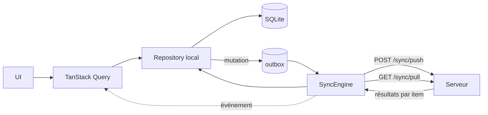

### 11.2 Cycle d'une mutation

1. L'UI appelle une mutation TanStack Query (mise à jour optimiste du cache).
2. Le repository écrit la ligne locale avec `version` inchangée, `dirty = 1`, et insère une entrée `outbox` (`clientMutationId` UUID v7, `entityType`, `entityId`, `operation`, `payload`, `baseVersion`, `createdAt`).
3. Si le réseau est disponible, le `SyncEngine` draine l'outbox par lots de 100, dans l'ordre de création, en respectant les dépendances (`create` avant `update` de la même entité).
4. Le serveur traite chaque item dans **une transaction par item** (pas par lot) et retourne un résultat par item.
5. En cas de succès : le client remplace la ligne locale par l'état serveur (`version` à jour), supprime l'entrée d'outbox.
6. En cas de `conflict` : le client conserve la version serveur et attache la version locale en `conflictCopy` (champ local, non synchronisé) ; l'UI affiche un bandeau « Modification concurrente » avec comparaison.
7. En cas de `rejected` (validation, permission, entité supprimée) : l'outbox est marquée en échec définitif, l'utilisateur est informé, la mutation optimiste est annulée.

### 11.3 Cycle d'un pull

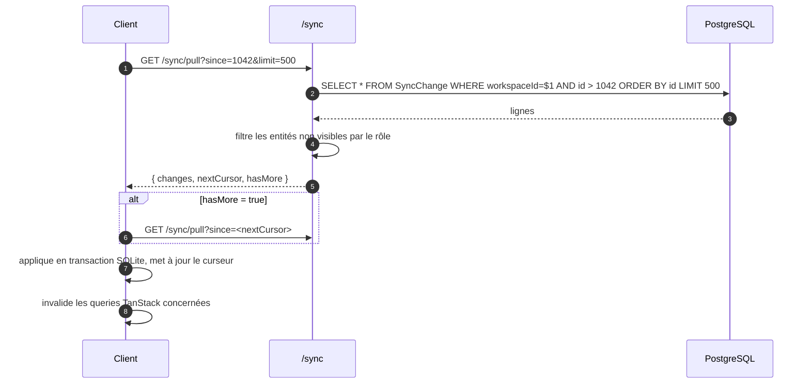

Règles :

- Le curseur est **monotone** (id `bigserial`), propre à chaque workspace, jamais à un utilisateur.
- Un client qui présente un curseur plus ancien que la rétention du journal (90 jours) reçoit `410 SYNC_CURSOR_EXPIRED` ; il doit alors appeler `/sync/snapshot` et remplacer sa base locale (les mutations en attente sont rejouées ensuite).
- Déclencheurs de pull : démarrage à froid, retour au premier plan, reconnexion réseau, après un push réussi et **toutes les 2 s en foreground** (RF-60, p95 < 5 s). Le lot est appliqué au miroir local puis les queries TanStack concernées sont invalidées.
- Aucun polling en arrière-plan : les rappels sont locaux ou poussés, pas synchronisés en boucle. Le WebSocket de collaboration reste une cible V1.3 ; la synchronisation multi-appareils M1 utilise le journal et le pull incrémental.

### 11.4 Résolution de conflits

| Nature du conflit | Stratégie | Visible utilisateur |
|---|---|---|
| Champs scalaires (`status`, `priority`, `dueDate`, `sortOrder`) | Dernier écrivain gagnant, comparaison par `updatedAt` serveur puis `actorId` (départage déterministe) | Non |
| `title` | LWW + conservation de la variante perdante dans `conflictCopy` | Bandeau discret |
| `description` (texte long) | Aucune fusion automatique : version serveur retenue, version locale conservée en `conflictCopy` | Résolution manuelle (choisir, fusionner, ignorer) |
| Suppression vs modification | La suppression gagne (`DELETE` prioritaire), sauf si la modification est postérieure de plus de 5 min → résurrection proposée | Notification dans l'app |
| Création hors ligne en double | UUID v7 généré côté client ⇒ déduplication naturelle | Non |
| Ordre dans une liste | `sortOrder` fractionnaire : deux insertions concurrentes au même point produisent deux valeurs distinctes, l'ordre final est stable et déterministe | Non |

**Limite assumée du MVP** : la fusion de texte riche en temps réel (type CRDT) n'est pas au programme. La collaboration V1.3 reste « chacun édite sa tâche », avec verrou optimiste et avertissement de concurrence.

### 11.5 Niveau d'offline par phase

| Phase | Lecture hors ligne | Écriture hors ligne |
|---|---|---|
| MVP | Oui — base locale alimentée par le pull | Non — mutations mises en file mais l'outbox n'est drainé qu'en ligne (message clair si hors ligne > 24 h) |
| V1.1 | Oui | Oui — outbox complet, push par lots, résolution de conflits complète |
| V1.3 | Oui | Oui + fusion temps réel des présences et des compteurs |

Cette progressivité est délibérée : livrer le protocole serveur (journal, versions, idempotence) dès le MVP évite une réécriture coûteuse, tout en gardant un périmètre de test réaliste.

---

## 12. Temps réel et collaboration (V1.3)

| Sujet | Décision |
|---|---|
| Transport | Socket.IO sur `/ws`, authentification par access token en `auth.token` du handshake |
| Rooms | `workspace:<id>`, `project:<id>`, `user:<id>` (notifications personnelles) |
| Événements serveur → client | `task.created`, `task.updated`, `task.deleted`, `task.moved`, `project.updated`, `presence.changed`, `notification.new` |
| Événements client → serveur | `subscribe`, `unsubscribe`, `typing` (édition d'une description) |
| Autorisation | Abonnement refusé si le membership n'est pas vérifié à chaque `subscribe` ; réévaluation à chaque changement de rôle |
| Cohérence | Le WebSocket est un **accélérateur**, pas une source de vérité : chaque événement porte `version` et est ignoré si `version <= versionLocale`. Un pull de réconciliation est forcé toutes les 5 min. |
| Présence | Éphémère, en mémoire + Redis (`presence:<projectId>` TTL 30 s), jamais persistée en base |
| Multi-instance | Adaptateur `@socket.io/redis-adapter` |

---

## 13. Notifications et traitement asynchrone

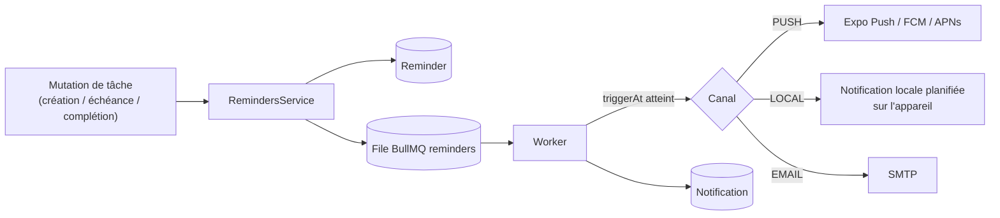

| Règle | Détail |
|---|---|
| Planification | Le worker utilise un job *delayed* par rappel, `jobId = reminder:<id>` (idempotence) |
| Replanification | Toute modification d'échéance supprime et recrée le job |
| Fuseau | `triggerAt` est calculé serveur en UTC à partir de `dueDate` + `dueTime` + `timezone` de l'utilisateur |
| Doublons | Un rappel déjà `sentAt` n'est jamais réémis ; les jobs en échec repassent 5 fois (backoff exponentiel) |
| Rappels locaux | Pour les appareils Android, une planification locale est préférée (`expo-notifications`) : elle survit à l'absence de réseau et évite la dépendance au worker |
| Préférences | L'utilisateur choisit canal et plage horaire silencieuse (doc 02, RF-xx) ; les notifications respectent ces préférences côté serveur |
| Purge | Jobs de maintenance : sessions expirées, tombstones > 90 j, outbox serveur inutilisée, exports > 7 j |

> **M1 (2026-11-28).** La redondance est en place : le serveur planifie et livre par Expo Push (`RemindersService` + worker de polling 30 s), et l'app Android planifie les mêmes instants localement (`expo-notifications`), avec report hors plage silencieuse et désactivation par catégorie/appareil. Le worker BullMQ de la cible reste remplaçable derrière `dispatchDue` ; l'écriture hors ligne (RF-62) n'est pas implémentée.

---

## 14. Infrastructure et déploiement

### 14.1 Environnements

| Environnement | Usage | Données | Accès |
|---|---|---|---|
| `local` | développement | Postgres/Redis/MinIO/MailHog via Docker Compose | libre |
| `preview` | une preview par pull request (API + web) | base éphémère, données synthétiques | équipe |
| `staging` | validation avant release | copie anonymisée de production | équipe |
| `production` | utilisateurs | réelles | restreint |

### 14.2 Topologie de production

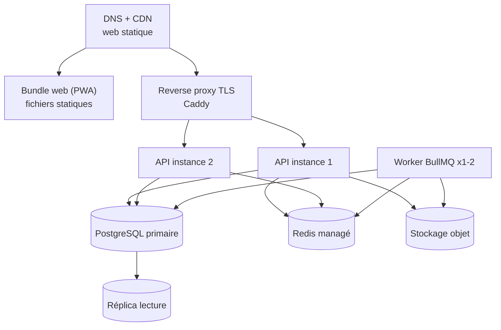

| Composant | Cible d'hébergement | Remarque |
|---|---|---|
| API + worker | Conteneurs Docker (PaaS ou VPS) | 2 instances API minimum en production, 1 worker (scalable horizontalement, jobs idempotents) |
| PostgreSQL | Service managé avec PITR, ou VPS avec `pgBackRest` | Sauvegarde quotidienne + WAL continu, rétention 30 j |
| Redis | Managé (AOF activé) | Perte acceptable = jobs rejoués depuis la base (source de vérité des rappels) |
| Web | CDN statique | En-têtes de cache immuables sur les assets hashés |
| Mobile | EAS Build + EAS Update | Canaux `development`, `preview`, `production` |
| Desktop | Installeurs signés (Tauri) | Windows (MSI/NSIS), macOS (DMG notarisé), Linux (AppImage/deb) |

### 14.3 Pipeline CI/CD (cible)

```mermaid
flowchart LR
    pr["Pull request"] --> lint["lint + typecheck"]
    lint --> unit["tests unitaires"]
    unit --> int["tests d'intégration<br/>Postgres éphémère"]
    int --> build["build api + web"]
    build --> e2e["e2e web (Playwright)"]
    e2e --> preview["déploiement preview"]
    preview --> review["revue humaine"]
    review --> merge["merge sur main"]
    merge --> stage["déploiement staging + migrations"]
    stage --> smoke["smoke tests"]
    smoke --> prod["production (approbation manuelle)"]
```

| Règle | Détail |
|---|---|
| Migrations | Appliquées automatiquement en staging, **avec approbation** en production ; toujours rétrocompatibles (expand/contract) |
| Rollback | Image précédente + migrations additives uniquement ; jamais de `DROP` dans la même release que le code qui l'utilise |
| Versionnement | `MAJOR.MINOR.PATCH` applicatif + `versionCode` Android incrémental |
| Feature flags | Table `FeatureFlag` + évaluation serveur, pour les modules V1.x |

### 14.4 Sauvegardes et reprise

| Indicateur | Cible |
|---|---|
| RPO | ≤ 15 min (WAL continu) |
| RTO | ≤ 2 h (restauration vérifiée trimestriellement) |
| Test de restauration | Procédure documentée en doc 03 §runbooks, exécutée chaque trimestre sur staging |

---

## 15. Sécurité

### 15.1 Modèle de menaces (extrait STRIDE)

| Menace | Scénario | Contre-mesure |
|---|---|---|
| Spoofing | Vol de refresh token | Rotation + détection de réutilisation + révocation de famille + liaison appareil |
| Tampering | Client qui envoie `workspaceId` d'un autre tenant | `workspaceId` **jamais** accepté du corps ; dérivé de la ressource et du membership vérifié |
| Repudiation | Contestation d'une suppression | `AuditLog` sur actions sensibles |
| Information disclosure | Fuite d'une pièce jointe par URL devinable | URLs présignées courtes (5 min), clés UUID non énumérables, contrôle d'accès à la confirmation |
| Denial of service | Rafale de créations | Rate limiting par utilisateur + quotas par workspace |
| Elevation of privilege | Passage `VIEWER` → `ADMIN` | Rôles vérifiés serveur, `WorkspaceGuard` + policies testées, aucun rôle lu depuis le client |
| Injection | Recherche plein texte | Requêtes paramétrées Prisma / `$queryRaw` avec `Prisma.sql`, jamais de concaténation |
| XSS (web) | Contenu utilisateur rendu | Pas de `dangerouslySetInnerHTML` ; éditeur de texte limité à un sous-ensemble Markdown assaini |
| SSRF | Import d'URL (V2) | Liste blanche de protocoles, résolution DNS contrôlée, pas d'accès aux IP privées |

### 15.2 Mesures transverses

- Argon2id (`memoryCost 19456 KiB`, `timeCost 2`, `parallelism 1`) pour les mots de passe.
- TLS 1.2+ imposé, HSTS, `helmet`, CORS liste blanche stricte, cookies `Secure`/`HttpOnly`/`SameSite=Strict`.
- Secrets injectés par l'environnement, jamais commités ; rotation documentée.
- Validation stricte en entrée **et** en sortie (les réponses sont construites par mapping explicite, jamais par `return entity`).
- Journalisation sans données sensibles (pas de token, pas de mot de passe, e-mail masqué dans les logs).
- Dépendances : `pnpm audit` en CI, Renovate/Dependabot, revue des avis de sécurité.

---

## 16. Performance et budgets

| Indicateur | Cible MVP | Mesure |
|---|---|---|
| p95 API lectures | < 200 ms | OpenTelemetry + histogrammes |
| p95 API écritures | < 350 ms | idem |
| p95 `/sync/pull` (500 changements) | < 400 ms | idem |
| Démarrage app Android (cold, milieu de gamme) | < 1,8 s jusqu'à interactif | trace de démarrage |
| Shell web (TTI, 4G simulée) | < 2,5 s | Lighthouse CI |
| Mémoire app (session 30 min, 500 tâches) | < 250 Mo | profilage natif |
| Taille de l'APK | < 45 Mo | build EAS |
| Base locale SQLite (10 000 tâches) | < 20 Mo, requêtes < 30 ms | bench local |

Leviers prévus : index composites, pagination par curseur, `select` Prisma explicite (jamais d'entité complète en liste), compression HTTP, cache HTTP `ETag` sur les lectures stables, virtualisation de listes, images en `blurhash`, workers séparés.

---

## 17. Évolutivité et trajectoire

| Palier | Déclencheur | Action |
|---|---|---|
| 10 000 utilisateurs actifs | charge API soutenue | 2–3 instances API, réplica de lecture pour `/stats`, Redis managé |
| 100 000 utilisateurs | volume du journal de sync | partitionnement de `SyncChange` par mois, archivage froid, cache Redis des agrégats |
| Collaboration intensive | contention d'écriture sur tâches partagées | verrou par tâche, présence, éventuellement CRDT ciblé sur la description |
| Multi-région | latence hors Europe | réplica régional en lecture, écritures en région primaire, CDN global |
| Extraction de service | un module dépasse 30 % du CPU | extraction du module (ex. `notifications`) avec file d'événements — pas avant mesure |

---

## 18. Risques architecturaux et dette assumée

| Risque | Impact | Probabilité | Mitigation |
|---|---|---|---|
| React Native Web insuffisant pour la densité desktop | Moyen | Moyenne | Porte de sortie ADR-002, abstraction `packages/ui`, budget Lighthouse CI |
| Protocole de sync complexe à tester | Élevé | Élevée | Tests de convergence (doc 03 §tests), scénarios multi-appareils scriptés dès le MVP |
| Notre pile mobile/desktop occupe toute l'équipe | Moyen | Moyenne | MVP limité (doc 02), PWA avant Tauri |
| Coût de la matrice WebView Tauri | Faible | Moyenne | Tauri repoussé en V1.1, PWA par défaut |
| Redis single point of failure | Moyen | Faible | Jobs reconstructibles depuis la base, alertes, persistance AOF |
| Accessibilité web négligée (RNW) | Moyen | Élevée | Checklist WCAG intégrée à la Definition of Done (doc 04), audit avant release |

**Dette assumée au MVP** (documentée, volontaire, avec échéance) :

1. Pas de fusion collaborative de texte riche.
2. Pas de sections de projet ni de listes imbriquées au-delà des sous-tâches.
3. Pas de notifications Web/Desktop au MVP (Android uniquement).
4. Pas de mode multi-tenant facturé (espaces partagés en V1.3).

---

## 19. Annexes

### 19.1 Ports et URLs locales

| Service | URL / port |
|---|---|
| API | `http://localhost:4000` (`/api/v1`, `/health`, Swagger sur `/docs` en dev) |
| Expo (Metro + web) | `http://localhost:8081` |
| PostgreSQL | `localhost:5432`, base `focus_dev` |
| Redis | `localhost:6379` |
| MinIO | `http://localhost:9000` (console `9001`) |
| MailHog | SMTP `1025`, UI `8025` |
| Tauri dev (V1.1) | charge `http://localhost:8081` |

### 19.2 Nomenclature

| Élément | Convention | Exemple |
|---|---|---|
| Tables | `PascalCase` singulier (Prisma) | `Task`, `SyncChange` |
| Colonnes | `camelCase` (Prisma mappe en `snake_case` SQL) | `dueDate` → `due_date` |
| Endpoints | `kebab-case` pluriel | `/focus-sessions` |
| Événements | `domaine.action` | `task.completed` |
| Jobs | `<file>:<type>` | `reminders:send` |
| Variables d'env | `SCREAMING_SNAKE_CASE` | `JWT_ACCESS_TTL` |
| Paquets | `@focus/<nom>` | `@focus/contracts` |

### 19.3 Glossaire d'architecture

| Terme | Définition |
|---|---|
| **Workspace** | Conteneur racine des données d'un utilisateur (ou d'une équipe). Toute ressource métier y appartient. |
| **Inbox** | Liste virtuelle des tâches sans `projectId`. |
| **Outbox** | File locale des mutations non encore confirmées par le serveur. |
| **Curseur de sync** | Position monotone dans le journal `SyncChange`, propre à un workspace. |
| **Tombstone** | Enregistrement de suppression conservé pour propager l'effacement aux clients. |
| **Verrou optimiste** | Contrôle de concurrence par `version`/`If-Match`, sans verrou base. |
| **RRULE** | Format standard RFC 5545 de description d'une récurrence. |
| **LWW** | *Last Writer Wins* — stratégie de résolution de conflit par horodatage. |

---

**Fin du document 01.**
