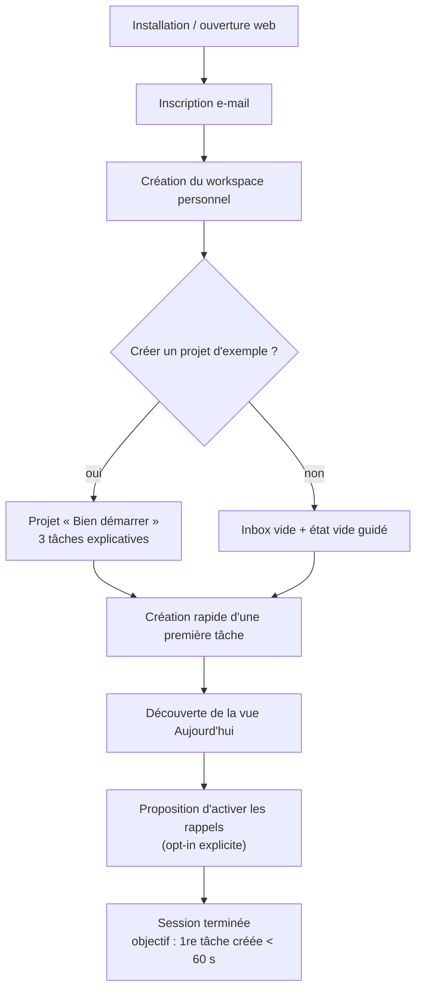
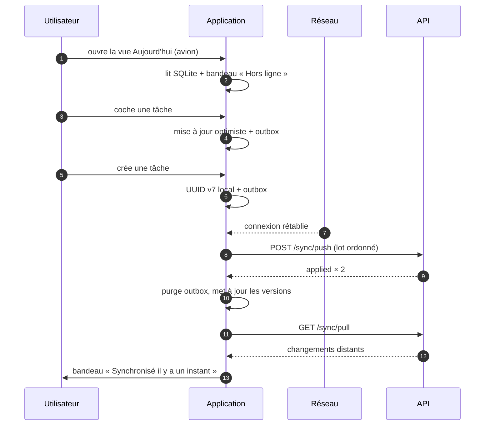

# 02 — Cahier des charges fonctionnel

> **Projet :** Focus — gestion de tâches et productivité
> **Statut :** v1.0 — référence produit pour le MVP et les versions suivantes
> **Public :** product owner, architecte, développeurs, designers, QA
> **Documents liés :** [01-ARCHITECTURE.md](./01-ARCHITECTURE.md) · [03-DOCUMENTATION-TECHNIQUE.md](./03-DOCUMENTATION-TECHNIQUE.md) · [04-BEST-PRACTICES.md](./04-BEST-PRACTICES.md) · [05-SKILLS-AND-TOOLS.md](./05-SKILLS-AND-TOOLS.md)

---

## 1. Vision du produit

### 1.1 Énoncé de vision

> **Focus** est un espace de travail personnel qui rassemble tâches, échéances, habitudes et temps de concentration dans une interface calme et dense. L'utilisateur n'y subit pas une accumulation de fonctionnalités : il y trouve **une seule vue qui répond à la question « que dois-je faire maintenant ? »**, et des vues spécialisées quand il a besoin de planifier, de mesurer ou de partager.

### 1.2 Positionnement

TickTick sert de **référence fonctionnelle** (quelles capacités sont attendues d'une application de gestion de tâches mature), jamais de référence visuelle, ergonomique ou technique. Focus se distingue par :

| Axe | TickTick (référence fonctionnelle) | Focus (parti pris) |
|---|---|---|
| Priorité produit | Couverture fonctionnelle large | **Clarté décisionnelle** : une vue « Aujourd'hui » qui hiérarchise, pas un tableau de bord de tout |
| Identité | Interface dense et colorée, proche des PIM classiques | **« Papier calme »** : surfaces mates, un seul accent par écran, typographie lisible, densité maîtrisée |
| Modèle d'organisation | Listes, dossiers, tags, filtres puissants | **Projets + Inbox + vues transverses** ; les filtres avancés arrivent quand les données le justifient |
| Concentration | Minuteur Pomodoro intégré | Minuteur **ancré sur la tâche active**, avec mesure réelle du temps (V1.1/V1.2) |
| Collaboration | Partage de listes | Partage **par projet** avec rôles explicites, introduit tardivement et proprement (V1.3) |
| Technique | — | Monorepo TypeScript, Expo (Android/Web/Desktop), NestJS, PostgreSQL, protocole de sync propriétaire |

**Ce que Focus ne fera pas** : ce n'est ni un gestionnaire de projet d'entreprise (Gantt, dépendances complexes, ressources), ni un clone d'interface. Toute demande allant dans ce sens doit être refusée au MVP.

### 1.3 Proposition de valeur

1. **Décider vite** : la vue Aujourd'hui propose un ordre, elle ne se contente pas de lister.
2. **Ne rien perdre** : capture en 2 gestes, fonctionne hors ligne, se synchronise sans conflit visible.
3. **Comprendre son temps** : temps estimé vs temps réel, sessions de concentration, séries d'habitudes.
4. **Rester calme** : interface sobre, notifications maîtrisées, aucun mécanisme de gamification intrusif.

---

## 2. Objectifs

### 2.1 Objectifs produit

| ID | Objectif | Indicateur de réussite (12 mois) |
|---|---|---|
| OBJ-1 | Offrir une capture de tâche sans friction | ≥ 80 % des créations réalisées en < 10 s (mesure télémétrie interne, opt-in) |
| OBJ-2 | Rendre la vue Aujourd'hui réellement utile | ≥ 50 % des sessions actives commencent par la vue Aujourd'hui |
| OBJ-3 | Fiabiliser le multi-appareils | ≥ 99,5 % des mutations synchronisées sans conflit visible |
| OBJ-4 | Installer une habitude d'usage | ≥ 35 % de rétention à J30 sur les utilisateurs ayant créé ≥ 5 tâches |
| OBJ-5 | Couvrir les trois plateformes | builds Android, Web et Desktop disponibles sur les trois OS desktop |

### 2.2 Objectifs techniques (détail : doc 01 §16 et §7 de ce document)

| ID | Objectif |
|---|---|
| OT-1 | Une base de code TypeScript unique, contrats partagés front/back |
| OT-2 | p95 API < 200 ms en lecture, < 350 ms en écriture |
| OT-3 | Démarrage Android < 1,8 s sur appareil milieu de gamme |
| OT-4 | Aucune perte de donnée en cas de coupure réseau (outbox persistante) |
| OT-5 | Conformité WCAG 2.2 AA sur la cible web |

### 2.3 Non-objectifs (explicites)

- Pas de gestion de projet d'équipe (dépendances, jalons, Gantt, charge).
- Pas de facturation ni de gestion commerciale.
- Pas de chat temps réel.
- Pas de marketplace d'extensions au MVP.
- Pas d'IA générative au MVP (voir §7.4 pour la vision V2 et ses conditions).

---

## 3. Utilisateurs

### 3.1 Personas

#### Persona 1 — Amina, 29 ans, cheffe de projet digital

- **Contexte** : 40 à 60 tâches ouvertes, 3 projets clients, réunions imprévues, travail sur ordinateur + téléphone.
- **Besoins** : voir ce qui est urgent *et* ce qui est reporté, retrouver une tâche en 3 secondes, ne pas perdre le fil quand elle change d'appareil.
- **Frustrations** : applications qui affichent 200 lignes sans hiérarchie ; perte de saisie hors connexion ; rappels ignorés.
- **Critères d'adoption** : rapidité de capture, vue Aujourd'hui pertinente, fiabilité de la synchronisation.
- **Fonctionnalités clés** : RF-20 à RF-34, RF-50, RF-51.

#### Persona 2 — Théo, 22 ans, étudiant en master

- **Contexte** : sessions de révision, devoirs à échéances, budgets serrés, usage majoritairement mobile.
- **Besoins** : planifier des blocs de travail, mesurer le temps réellement travaillé, tenir des habitudes (révisions quotidiennes), travailler dans les transports sans réseau.
- **Frustrations** : abonnements, interfaces surchargées, minuteurs qui se réinitialisent quand l'écran s'éteint.
- **Critères d'adoption** : gratuité du cœur de l'app, mode hors ligne, minuteur fiable.
- **Fonctionnalités clés** : RF-35 à RF-45, RF-60 à RF-64, RF-70.

#### Persona 3 — Karim, 41 ans, consultant indépendant

- **Contexte** : suit son temps facturable, travaille sur desktop, veut exporter ses données.
- **Besoins** : suivi du temps par tâche, statistiques hebdomadaires, export CSV, partage ponctuel d'un projet avec un client.
- **Frustrations** : données enfermées, exports incomplets, applications desktop lourdes.
- **Critères d'adoption** : application desktop légère, export complet, propriété des données.
- **Fonctionnalités clés** : RF-46 à RF-49, RF-65, RF-80, RF-92.

#### Persona 4 — Léa, 34 ans, développeuse (utilisatrice avancée)

- **Contexte** : vit au clavier, veut automatiser, teste les produits en profondeur.
- **Besoins** : raccourcis clavier, recherche rapide, vues sauvegardées, cohérence des comportements entre plateformes.
- **Fonctionnalités clés** : RF-33, RF-34, RF-55, RF-90.

### 3.2 Tâches utilisateur (Jobs To Be Done)

| JTBD | Situation | Attente |
|---|---|---|
| JTBD-1 | Une idée surgit en réunion | La noter en moins de 10 secondes, sans choisir de projet |
| JTBD-2 | Début de journée | Savoir quoi faire dans quel ordre, sans recomposer la liste |
| JTBD-3 | Une réunion décale tout | Décaler plusieurs tâches rapidement, sans casser les échéances |
| JTBD-4 | Planifier la semaine | Voir la charge réelle et repérer les journées surchargées |
| JTBD-5 | Travailler dans le train | Consulter, cocher, créer — même sans réseau |
| JTBD-6 | Se concentrer | Lancer un minuteur sur une tâche précise et mesurer le résultat |
| JTBD-7 | Faire le point | Voir ce qui a été accompli et où le temps est passé |
| JTBD-8 | Tenir une routine | Cocher une habitude quotidienne et voir sa série |

### 3.3 Segments et priorités

| Segment | Priorité | Justification |
|---|---|---|
| Professionnels individuels organisés | P0 | Cœur de cible, sensibles à la fiabilité et au multi-appareils |
| Étudiants | P1 | Fort volume, sensibles au prix, moteur de croissance |
| Indépendants / freelances | P1 | Prêts à payer pour temps et statistiques |
| Petites équipes (2–10) | P2 | V1.3, ne doit pas complexifier le MVP |

---

## 4. Périmètre et découpage des versions

### 4.1 Principe de découpage

Le MVP doit être **utilisable seul, tous les jours, par une personne**. Une fonctionnalité n'entre dans le MVP que si elle sert la boucle : *capturer → planifier → exécuter → constater*.

| Version | Thème | Contenu (résumé) |
|---|---|---|
| **M0 — Fondations** | Outillage | monorepo, CI, design tokens, auth, schéma de base, protocole de sync serveur |
| **M1 — MVP** | Boucle quotidienne | tâches, sous-tâches, projets, priorités, tags, échéances, rappels, récurrence simple, vues Aujourd'hui / Prochain / Inbox / Liste / Calendrier / Kanban, recherche, paramètres, cache hors ligne en lecture, Android + Web (PWA) |
| **M2 — V1.1** | Concentration et desktop | Pomodoro, matrice d'Eisenhower, statistiques de base, écriture hors ligne, app desktop Tauri, notifications Web/Desktop |
| **M3 — V1.2** | Habitudes et temps | habitudes et séries, suivi du temps, rapports hebdomadaires, exports |
| **M4 — V1.3** | Collaboration | projets partagés, rôles, commentaires, temps réel, centre de notifications partagé |
| **V2** | Intelligence et intégrations | modèles de tâches, règles d'automatisation, intégrations calendaires entrantes, assistance IA |

> Le détail des phases M0–M4 et les critères de sortie figurent en §9.

### 4.2 Méthode de priorisation (MoSCoW)

| Catégorie | Définition appliquée |
|---|---|
| **Must** | Sans elle, le produit ne remplit pas sa promesse quotidienne |
| **Should** | Forte valeur, contournable au MVP |
| **Could** | Confort, à faire si le temps le permet |
| **Won't (cette version)** | Explicitement exclu, documenté pour éviter les débats récurrents |

---

## 5. Fonctionnalités détaillées

Chaque fonctionnalité porte un identifiant stable (`RF-xx`), réutilisé dans les tests, les tickets et la roadmap. Les critères d'acceptation sont rédigés au format **Étant donné / Quand / Alors**.

### 5.1 Comptes et accès

#### RF-01 — Inscription et connexion par e-mail

| | |
|---|---|
| **Priorité** | Must — M1 |
| **Description** | Inscription par e-mail + mot de passe (min. 10 caractères, vérification de robustesse), connexion, déconnexion. Un workspace personnel nommé « Espace de <prénom> » est créé automatiquement. |
| **Règles** | E-mail unique (insensible à la casse) ; mot de passe haché en Argon2id ; jeton d'accès 15 min ; refresh 30 j avec rotation ; 5 tentatives échouées ⇒ verrouillage progressif (1 min, 5 min, 15 min). |
| **Hors périmètre** | Vérification d'e-mail obligatoire (recommandée mais non bloquante au MVP), MFA (V1.2). |
| **Critères d'acceptation** | *Étant donné* un e-mail non utilisé, *quand* je m'inscris avec un mot de passe valide, *alors* je suis connecté et un workspace personnel existe. *Étant donné* 5 échecs consécutifs, *quand* je retente, *alors* la réponse est `429` avec un délai explicite. |

#### RF-02 — Réinitialisation du mot de passe

Must — M1. Envoi d'un lien à usage unique (30 min, usage unique, haché en base). La réponse est toujours `202` (pas d'énumération d'e-mails). Le changement révoque toutes les sessions.

#### RF-03 — Gestion des sessions et des appareils

Must — M1. L'utilisateur voit la liste de ses sessions actives (plateforme, date, dernière activité), peut révoquer une session ou toutes. La détection de réutilisation d'un refresh token révoque la famille entière et journalise l'événement.

#### RF-04 — Profil et préférences

Must — M1. Nom affiché, avatar (initiales par défaut), fuseau horaire (IANA, détection initiale), langue (`fr`/`en`), début de semaine (`lundi`/`dimanche`), format d'heure (12 h/24 h), thème (clair/sombre/système).

#### RF-05 — OAuth Google / Apple

Should — V1.1. Connexion sociale, liaison de compte par e-mail vérifié, jamais de fusion automatique sur e-mail non vérifié.

#### RF-06 — Suppression de compte

Must — M1. Demande avec confirmation forte, export proposé, suppression logique immédiate, purge définitive après 30 jours (job), e-mail de confirmation.

### 5.2 Projets et organisation

#### RF-10 — Projets

| | |
|---|---|
| **Priorité** | Must — M1 |
| **Description** | Créer, renommer, colorer, décrire, archiver, supprimer un projet. Ordre personnalisable. Un projet contient des tâches. |
| **Règles** | Nom 1–80 caractères, unique par workspace (insensible à la casse) ; couleur issue d'une palette de 12 teintes accessibles ; archivage = lecture seule (les tâches restent consultables) ; suppression = soft delete, tâches déplacées vers la corbeille du projet puis purgées. |
| **Critères d'acceptation** | *Étant donné* deux projets « Client A », *quand* je crée un troisième « client a », *alors* la réponse est `409 CONFLICT` avec un message explicite. |

#### RF-11 — Inbox

Must — M1. Toute tâche créée sans projet atterrit dans l'Inbox. L'Inbox ne peut pas être supprimée, seulement vidée (déplacement en masse).

#### RF-12 — Tri et réorganisation

Must — M1. Ordre manuel par glisser-déposer (long press sur mobile), `sortOrder` fractionnaire côté serveur, réordonnancement persistant et synchronisé. Tri alternatif : échéance, priorité, date de création, alphabétique.

#### RF-13 — Sections de projet

Could — V1.1. Sous-groupes nommés à l'intérieur d'un projet (ex. « À faire », « En attente client »). Non inclus au MVP pour limiter la profondeur hiérarchique.

#### RF-14 — Vues sauvegardées

Should — V1.2. Combinaison de filtres nommée et épinglée (ex. « Urgent sans projet »).

### 5.3 Tâches

#### RF-20 — Création rapide

| | |
|---|---|
| **Priorité** | Must — M1 |
| **Description** | Saisie d'un titre seul, avec analyse légère de la syntaxe naturelle : `demain`, `lundi`, `12/03`, `!haute`, `#tag`, `@projet`, `*récurrence`. La création rapide ne bloque jamais sur un formulaire complet. |
| **Règles** | Titre 1–500 caractères ; l'analyse syntaxique est **désactivable** dans les paramètres ; en cas d'ambiguïté, le texte est conservé tel quel (jamais de perte) ; un aperçu des valeurs interprétées est affiché avant validation sur mobile. |
| **Critères d'acceptation** | *Étant donné* la saisie « Appeler le comptable demain 9h !haute #admin », *quand* je valide, *alors* une tâche est créée avec échéance au lendemain, priorité haute, tag `admin`, et le titre affiché reste lisible (« Appeler le comptable »). *Étant donné* la même saisie avec l'analyse désactivée, *alors* tout le texte devient le titre. |

#### RF-21 — Édition complète

Must — M1. Panneau de détail : titre, description (texte enrichi limité : gras, italique, listes, liens, cases à cocher), projet, échéance (date + heure optionnelle), priorité, tags, rappels, récurrence, estimation, sous-tâches, pièces jointes (V1.1).

#### RF-22 — Sous-tâches

| | |
|---|---|
| **Priorité** | Must — M1 |
| **Description** | Une tâche peut contenir des sous-tâches (une seule profondeur au MVP, maximum 50). Cocher toutes les sous-tâches propose la complétion du parent (jamais automatique). |
| **Règles** | Une sous-tâche hérite du projet du parent ; elle ne peut pas avoir d'échéance propre au MVP (l'échéance du parent fait foi) ; la suppression du parent supprime les enfants. |
| **Critères d'acceptation** | *Étant donné* une tâche avec 3 sous-tâches, *quand* je coche les 3, *alors* une suggestion « Terminer la tâche parente ? » apparaît, et je peux refuser. |

#### RF-23 — Statuts et complétion

Must — M1. Statuts : `TODO`, `IN_PROGRESS`, `DONE`, `CANCELLED`. La complétion enregistre `completedAt`. Une tâche terminée est masquée par défaut mais consultable (filtre « Terminées »). Réouverture possible, `completedAt` remis à `null`. Une tâche annulée n'entre pas dans les statistiques d'accomplissement.

#### RF-24 — Priorités

Must — M1. Cinq niveaux : `NONE`, `LOW`, `MEDIUM`, `HIGH`, `URGENT`, avec code couleur **et** libellé (jamais la couleur seule — accessibilité). L'ordre par défaut de la vue Aujourd'hui est : urgent > haute > échéance la plus proche > moyenne > basse > aucune.

> **Note de conception** : les priorités sont indépendantes de la matrice d'Eisenhower (RF-42). La matrice est une vue calculée à partir de l'urgence (échéance) et de l'importance (priorité), jamais un second champ.

#### RF-25 — Échéances et dates

| | |
|---|---|
| **Priorité** | Must — M1 |
| **Description** | Date d'échéance, heure optionnelle, date de début optionnelle. Raccourcis : aujourd'hui, demain, ce week-end, lundi prochain, date personnalisée. |
| **Règles** | Une échéance sans heure est une **date civile** (pas d'heure limite implicite : elle ne passe pas « en retard » à minuit, mais au début du jour suivant dans le fuseau de l'utilisateur). Une échéance avec heure est un instant. Changement de fuseau ⇒ recalcul d'affichage, pas de modification de la valeur stockée. |
| **Critères d'acceptation** | *Étant donné* une tâche échéant aujourd'hui sans heure, *quand* il est 23 h 50, *alors* elle n'est pas marquée en retard. *Étant donné* la même tâche, *quand* il est 00 h 05 le lendemain, *alors* elle apparaît en retard. |

#### RF-26 — Tags

Must — M1. Tags libres par workspace, nom unique insensible à la casse, couleur, maximum 20 par tâche, 100 par workspace. Filtrage multi-tags en ET.

#### RF-27 — Recherche

Must — M1. Recherche plein texte sur titre et description (PostgreSQL FTS, dictionnaire `simple` pour neutraliser les langues), insensible aux accents, résultats classés puis filtrés par projet/statut. Résultats < 150 ms sur 10 000 tâches.

#### RF-28 — Tâches récurrentes

| | |
|---|---|
| **Priorité** | Must (formes simples) — M1 ; Should (formes avancées) — V1.1 |
| **Description** | Récurrence : quotidienne, jours de semaine, hebdomadaire (jours choisis), mensuelle (jour du mois ou nième jour de semaine), annuelle, toutes les N unités. Deux modes : **date fixe** (l'occurrence suivante est calculée depuis l'échéance précédente) et **après complétion** (calculée depuis la date de complétion). |
| **Règles** | RRULE RFC 5545 stockée telle quelle ; limite de 500 occurrences générées à la demande ; une occurrence terminée est archivée comme tâche historique (`DONE`) et l'occurrence suivante est créée ; si la tâche est en retard de plus d'un intervalle, une seule occurrence est proposée (pas de rattrapage en cascade). |
| **Critères d'acceptation** | *Étant donné* une tâche « Réviser » récurrente tous les lundis en date fixe, *quand* je la termine un mercredi, *alors* l'occurrence suivante est le lundi suivant (pas le mercredi). *Étant donné* le mode « après complétion », *alors* l'occurrence suivante est le mercredi suivant. |
| **Limites MVP** | Pas de récurrence par intervalle de jours après complétion avec fenêtre, pas d'exceptions individuelles (`EXDATE`) éditables, pas de récurrence sur sous-tâches. |

#### RF-29 — Corbeille

Must — M1. Toute suppression est réversible pendant 30 jours (tâches et projets). Restauration en un geste, purge automatique documentée.

#### RF-30 — Suppression en masse et actions groupées

Should — V1.1. Sélection multiple, déplacement, changement de priorité, complétion et suppression en lot.

### 5.4 Vues et planification

#### RF-31 — Vue Aujourd'hui (cœur du produit)

| | |
|---|---|
| **Priorité** | Must — M1 |
| **Description** | Agrégat unique : (1) tâches en retard, (2) tâches échues aujourd'hui, (3) tâches en cours, (4) tâches épinglées du jour. Chaque section est repliable. Un compteur de charge affiche le total d'estimation. |
| **Règles** | L'ordre est déterministe (priorité, puis échéance, puis `sortOrder`) ; aucune tâche sans échéance n'apparaît ici sauf si épinglée ; les tâches terminées aujourd'hui apparaissent dans une section repliée « Accomplies ». |
| **Critères d'acceptation** | *Étant donné* 3 tâches en retard, 2 dues aujourd'hui et 1 terminée, *quand* j'ouvre Aujourd'hui, *alors* je vois 2 sections ouvertes (En retard, Aujourd'hui) et 1 section repliée contenant la tâche terminée, dans cet ordre. |

#### RF-32 — Vue Prochain (7 jours)

Must — M1. Regroupement par jour sur 7 jours glissants, en-tête de charge par jour (nombre de tâches + total estimé), indication visuelle des journées surchargées (> 8 h estimées ou > 12 tâches).

#### RF-33 — Vue Calendrier

| | |
|---|---|
| **Priorité** | Must (mois + semaine) — M1 ; Should (jour, agenda, glisser-déposer) — V1.1 |
| **Description** | Affichage des tâches par échéance. Mois : pastilles et compteurs par jour. Semaine : colonnes horaires si les tâches ont une heure, sinon liste par jour. Navigation par mois/semaine, retour à aujourd'hui. |
| **Règles** | Affichage en lecture seule au MVP (création/déplacement par glisser-déposer en V1.1) ; les occurrences récurrentes futures sont affichées à la volée, sans être persistées. |
| **Critères d'acceptation** | *Étant donné* une tâche récurrente hebdomadaire, *quand* j'affiche le mois suivant, *alors* les occurrences apparaissent aux bonnes dates sans créer de lignes en base. |

#### RF-34 — Vue Kanban

| | |
|---|---|
| **Priorité** | Must — M1 |
| **Description** | Colonnes fixes au MVP : « À faire » (`TODO`), « En cours » (`IN_PROGRESS`), « Terminé » (`DONE`). Déplacement d'une carte = changement de statut + position. |
| **Règles** | Une carte affiche titre, projet, échéance, priorité, tags, indicateur de sous-tâches ; limite optionnelle de travail en cours (WIP) par colonne en V1.1 ; le Kanban est par projet uniquement au MVP. |
| **Critères d'acceptation** | *Étant donné* une carte en « À faire », *quand* je la dépose en « Terminé », *alors* son statut devient `DONE`, `completedAt` est renseigné et la modification est visible sur un autre appareil après synchronisation. |

#### RF-35 — Filtres

Must — M1. Filtres combinables : statut, priorité, tags (ET), projet, échéance (en retard / aujourd'hui / 7 jours / sans date), texte. Les filtres actifs sont visibles sous forme de puces retirables.

#### RF-36 — Raccourcis clavier (web et desktop)

Should — V1.1. Navigation `j`/`k`, création `c`, recherche `/`, complétion `x`, ouverture `Entrée`, fermeture `Échap`, changement de vue `1`–`6`. Une feuille de raccourcis est accessible via `?`.

### 5.5 Concentration et mesure

#### RF-40 — Mode concentration (Pomodoro)

| | |
|---|---|
| **Priorité** | Should — V1.1 |
| **Description** | Minuteur lié à une tâche : 25 min de concentration, 5 min de pause courte, pause longue après 4 cycles. Durées configurables. Le temps effectif est enregistré. |
| **Règles** | La source de vérité est `startedAt` + `plannedSeconds` + `phase` (jamais un compteur en mémoire) : le minuteur survit à la mise en arrière-plan et au redémarrage. Un cycle interrompu est enregistré comme `completed: false` avec le temps réel. Les notifications de fin sont locales, jamais dépendantes du réseau. |
| **Critères d'acceptation** | *Étant donné* un cycle lancé, *quand* je tue l'application après 10 min puis la relance, *alors* le minuteur affiche 15 min restantes et le cycle est toujours actif. |

#### RF-41 — Suivi du temps

Should — V1.2. Chronomètre par tâche, saisie manuelle, correction d'une entrée, total par tâche/projet/jour. Une seule entrée active par utilisateur à la fois (contrainte serveur).

#### RF-42 — Matrice d'Eisenhower

Should — V1.1. Vue à quatre quadrants calculée : urgent = échéance ≤ 48 h ou en retard ; important = priorité ≥ `HIGH`. Aucun champ dédié. Le déplacement d'une carte entre quadrants modifie la priorité et/ou l'échéance, avec confirmation explicite.

#### RF-43 — Suivi des habitudes

| | |
|---|---|
| **Priorité** | Should — V1.2 |
| **Description** | Créer une habitude (nom, icône, fréquence : jours de la semaine, N fois par semaine, tous les jours), cocher une entrée par jour, visualiser une série (streak) et un taux de réussite sur 30 jours. |
| **Règles** | Une entrée par couple (habitude, date) ; cocher deux fois est idempotent ; les séries sont calculées à la lecture (pas de compteur dénormalisé au MVP) ; fuseau de l'utilisateur = référentiel du « jour ». |
| **Critères d'acceptation** | *Étant donné* une habitude quotidienne cochée 4 jours d'affilée, *quand* je consulte le 5e jour avant de cocher, *alors* la série affichée est 4 et non 0. |

#### RF-44 — Statistiques

Should — V1.1 (base) / V1.2 (complet). Nombre de tâches accomplies par période, répartition par projet et par priorité, temps estimé vs réel, temps de concentration, taux de respect des échéances. Aucune comparaison sociale au MVP.

#### RF-45 — Bilan hebdomadaire

Could — V1.2. Récapitulatif automatique (accompli, reporté, temps) consultable dans l'app et, sur opt-in, envoyé par e-mail.

### 5.6 Notifications et rappels

#### RF-50 — Rappels

| | |
|---|---|
| **Priorité** | Must — M1 (Android) ; Should — V1.1 (Web, Desktop) |
| **Description** | Rappel à un instant précis ou relatif à l'échéance (à l'heure, 5/15/30 min avant, 1 h, 1 j). Plusieurs rappels par tâche (max 5). |
| **Règles** | Chaque rappel produit une notification locale planifiée sur l'appareil **et** un job serveur (redondance) ; un rappel déjà envoyé n'est jamais répété ; modification de l'échéance ⇒ replanification ; plage silencieuse respectée (les rappels hors plage sont reportés à l'ouverture de la plage, avec mention). |
| **Critères d'acceptation** | *Étant donné* un rappel à 9 h et une plage silencieuse 22 h–8 h, *quand* il est 9 h, *alors* la notification est délivrée. *Étant donné* un rappel à 23 h, *alors* il est reporté à 8 h avec la mention « Rappel reporté ». |

#### RF-51 — Notifications push

Must — M1 (Android via Expo Push) ; Should — V1.1 (Web Push, notifications natives Tauri). L'utilisateur peut désactiver par catégorie (rappels, résumé quotidien, collaboration) et par appareil.

#### RF-52 — Résumé quotidien

Could — V1.2. Un récapitulatif à l'heure choisie (nombre de tâches du jour, charge estimée).

#### RF-53 — Centre de notifications

Should — V1.3. Historique in-app des notifications (rappels manqués, invitations, mentions), avec état lu/non lu.

### 5.7 Synchronisation et hors ligne

#### RF-60 — Synchronisation multi-appareils

| | |
|---|---|
| **Priorité** | Must — M1 (serveur complet) / M1 partiel (client en lecture) |
| **Description** | Toute mutation confirmée est propagée aux autres appareils en moins de 5 s en ligne. Conflits résolus selon la politique du document 01 §11.4. |
| **Critères d'acceptation** | *Étant donné* deux appareils connectés, *quand* je crée une tâche sur A, *alors* elle apparaît sur B sans action manuelle en moins de 5 s (p95). |

#### RF-61 — Consultation hors ligne

Must — M1. Les projets, tâches et tags récents (workspace complet jusqu'à 10 000 tâches) restent consultables sans réseau. Un bandeau indique l'état de connexion et la dernière synchronisation.

#### RF-62 — Écriture hors ligne

Should — V1.1. Création, modification et complétion hors ligne, mises en file dans une outbox persistante, rejouées à la reconnexion, avec idempotence (aucun doublon).

#### RF-63 — Résolution des conflits

Should — V1.1. Application de la politique LWW par champ ; conflit sur description ⇒ comparaison et choix explicite (« garder la version de cet appareil », « garder la version du serveur », « fusionner »).

#### RF-64 — Réinitialisation locale

Must — M1. Action « Réinitialiser les données locales » (utile en cas de corruption), qui vide la base SQLite, conserve les mutations en attente si possible et force un snapshot complet.

### 5.8 Sécurité et confidentialité

#### RF-70 — Paramètres de sécurité

Must — M1 (sessions), V1.2 (MFA). Voir sessions actives, révoquer, changer le mot de passe, consulter les dernières connexions.

#### RF-71 — Export des données

Must — M1 (JSON complet) ; Should — V1.2 (CSV). Export asynchrone (job), lien de téléchargement valable 24 h, notification à la fin.

#### RF-72 — Confidentialité

Must — M1. Pas de tracker publicitaire tiers. Télémétrie produit **opt-in**, anonymisée, désactivable. Politique de conservation documentée (corbeille 30 j, tombstones 90 j, journaux 12 mois).

### 5.9 Collaboration

#### RF-80 — Projets partagés

| | |
|---|---|
| **Priorité** | Could — V1.3 |
| **Description** | Invitation par e-mail à un projet (ou workspace), rôles `OWNER`, `ADMIN`, `MEMBER`, `VIEWER`. Assignation de tâches, commentaires, présence. |
| **Règles** | Un `VIEWER` ne peut rien modifier ; un `MEMBER` ne peut pas gérer les membres ; seul un `OWNER` peut supprimer le workspace ; chaque action respecte la politique de rôle côté serveur (jamais côté client). |
| **Critères d'acceptation** | *Étant donné* un membre `VIEWER`, *quand* il envoie un `PATCH` sur une tâche, *alors* la réponse est `403` et aucune donnée n'est modifiée. |

> RF-80 est explicitement **hors MVP** : le modèle de données est prêt (workspaces et rôles), l'interface ne l'expose pas.

---

## 6. Exigences fonctionnelles transverses

| ID | Exigence | Détail |
|---|---|---|
| ETF-01 | Fuseaux horaires | Toute date est calculée dans le fuseau de l'utilisateur ; changement de fuseau = recalcul d'affichage uniquement |
| ETF-02 | Langue | Interface `fr` (défaut) et `en`, formats `Intl`, aucune chaîne codée en dur |
| ETF-03 | Accessibilité | Navigation clavier complète sur Web/Desktop, cibles ≥ 44 px sur mobile, contraste ≥ 4,5:1, libellés d'accessibilité sur chaque action, pas d'information par la couleur seule |
| ETF-04 | Densité | Trois densités (confortable, standard, compacte) sur Web/Desktop |
| ETF-05 | Thème | Clair, sombre, système ; pas de flash blanc au démarrage |
| ETF-06 | Performance perçue | Toute action < 100 ms en feedback visuel ; squelettes de chargement, jamais d'écran vide |
| ETF-07 | Robustesse | Aucune perte de saisie en cas d'erreur réseau ; brouillon local des formulaires longs |
| ETF-08 | Cohérence multi-plateforme | Même modèle de données et mêmes règles métier ; les écarts d'interface sont documentés |

---

## 7. Exigences non fonctionnelles

### 7.1 Performance

| ID | Exigence | Cible | Mesure |
|---|---|---|---|
| RNF-01 | Démarrage Android (cold, milieu de gamme) | < 1,8 s jusqu'à interactif | trace de démarrage |
| RNF-02 | Temps interactif web (4G simulée) | < 2,5 s | Lighthouse CI |
| RNF-03 | p95 lectures API | < 200 ms | OpenTelemetry |
| RNF-04 | p95 écritures API | < 350 ms | OpenTelemetry |
| RNF-05 | Recherche sur 10 000 tâches | < 150 ms | test de charge |
| RNF-06 | Synchronisation inter-appareils | < 5 s (p95) en ligne | test d'intégration |
| RNF-07 | Fluidité des listes | 60 fps en défilement sur 1 000 éléments virtualisés | profilage |
| RNF-08 | Taille APK | < 45 Mo | build EAS |
| RNF-09 | Mémoire app (session 30 min, 500 tâches) | < 250 Mo | profilage natif |

### 7.2 Fiabilité et disponibilité

| ID | Exigence | Cible |
|---|---|---|
| RNF-10 | Disponibilité API (mensuelle) | ≥ 99,5 % |
| RNF-11 | RPO / RTO | ≤ 15 min / ≤ 2 h |
| RNF-12 | Intégrité des mutations | 0 perte tolérée ; idempotence obligatoire du push |
| RNF-13 | Reprise après coupure | l'outbox survit à un kill de l'application |
| RNF-14 | Taux d'erreur API | < 0,5 % des requêtes (hors 4xx clients) |

### 7.3 Sécurité

| ID | Exigence |
|---|---|
| RNF-20 | Transport chiffré (TLS 1.2+) sur tous les environnements, y compris les previews |
| RNF-21 | Mots de passe hachés Argon2id, jamais journalisés |
| RNF-22 | Jetons d'accès en mémoire uniquement côté client |
| RNF-23 | Cloisonnement strict par workspace, testé par des tests négatifs automatisés |
| RNF-24 | Verrouillage progressif après échecs de connexion |
| RNF-25 | Dépendances sans vulnérabilité critique connue (`pnpm audit` bloquant en CI) |
| RNF-26 | Aucune donnée personnelle dans les logs (e-mail masqué) |

### 7.4 Maintenabilité et qualité

| ID | Exigence | Cible |
|---|---|---|
| RNF-30 | Couverture des règles métier (services, policies, sync) | ≥ 80 % lignes, ≥ 70 % branches |
| RNF-31 | Complexité cyclomatique par fonction | ≤ 10 |
| RNF-32 | TypeScript strict | 0 `any` implicite, 0 `@ts-expect-error` non justifié |
| RNF-33 | Délai de build CI complet | < 12 min |
| RNF-34 | Temps de reproduction d'un bug | diagnostic possible via `requestId` et traces |

### 7.5 Accessibilité et internationalisation

| ID | Exigence |
|---|---|
| RNF-40 | WCAG 2.2 niveau AA sur la cible web |
| RNF-41 | Navigation clavier sans piège de focus, focus visible personnalisé |
| RNF-42 | Compatibilité lecteurs d'écran : TalkBack (Android), VoiceOver (macOS/iOS), NVDA (Windows) sur les parcours critiques |
| RNF-43 | Textes traduits à 100 % en `fr` et `en`, aucune concaténation de phrases |
| RNF-44 | Interface utilisable avec une taille de police système augmentée de 200 % (mobile) sans perte de fonction |

### 7.6 Contraintes techniques et légales

| ID | Contrainte |
|---|---|
| RNF-50 | Node 22 LTS, pnpm, TypeScript strict (doc 01 ADR-016) |
| RNF-51 | Aucune dépendance à un fournisseur cloud exclusive dans le code applicatif |
| RNF-52 | Données hébergées dans l'UE par défaut (RGPD), sous-traitants documentés |
| RNF-53 | Export complet des données à la demande et suppression définitive possible |
| RNF-54 | Applications desktop et web sans télémétrie tierce embarquée |

---

## 8. Parcours utilisateurs

### 8.1 Parcours d'activation (première session)

**Critère d'activation retenu** : une tâche créée + une tâche complétée dans les 24 h suivant l'inscription.

### 8.2 Parcours quotidien

1. Ouverture → vue Aujourd'hui (mémorisée comme dernier écran si l'utilisateur le souhaite).
2. Complétion rapide d'une tâche (glissement sur mobile, case sur desktop).
3. Ajout d'une tâche capturée en réunion (création rapide depuis n'importe quel écran, bouton global).
4. Report d'une tâche à demain (action contextuelle « Demain »).
5. Consultation du prochain jour pour anticiper.

### 8.3 Parcours de planification hebdomadaire

1. Ouverture de la vue Prochain (7 jours).
2. Repérage des journées surchargées (indicateur de charge).
3. Report ou découpage des tâches excédentaires.
4. Passage en vue Calendrier pour vérifier la cohérence des échéances.
5. Optionnel : revue du Kanban d'un projet actif.

### 8.4 Parcours de concentration (V1.1)

1. Sélection d'une tâche → « Démarrer une session ».
2. Cycle de 25 min ; notification de fin ; pause courte.
3. Enregistrement automatique du temps sur la tâche.
4. Bilan de fin de journée dans les statistiques.

### 8.5 Parcours hors ligne

---

## 9. MVP, roadmap et critères de sortie

### 9.1 Contenu du MVP (M1)

| Domaine | Inclus | Exclu (assumé) |
|---|---|---|
| Comptes | e-mail/mot de passe, sessions, réinitialisation, profil, suppression | OAuth, MFA |
| Projets | CRUD, couleurs, archivage, ordre, Inbox | sections, partage |
| Tâches | CRUD, sous-tâches (1 niveau), statuts, priorités, tags, échéances, récurrence simple, corbeille | dépendances, pièces jointes, actions groupées |
| Vues | Aujourd'hui, Prochain, Inbox, Liste, Calendrier (mois/semaine), Kanban (lecture + déplacement) | Eisenhower, agenda, glisser-déposer calendrier |
| Rappels | locaux + push Android, plusieurs par tâche, plage silencieuse | Web/Desktop push |
| Recherche | plein texte + filtres | vues sauvegardées |
| Offline | lecture complète, bandeau d'état, réinitialisation locale | écriture hors ligne |
| Sync | journal serveur, pull, push en ligne, conflits scalaires | résolution manuelle de texte |
| Réglages | thème, langue, formats, densité, notifications | personnalisation avancée |
| Plateformes | Android, Web (PWA) | Desktop Tauri, iOS |

### 9.2 Roadmap

L'ordre des phases fait foi ; **aucune durée ni date cible n'est engagée** dans ce document.

| Phase | Objectif | Critères de sortie |
|---|---|---|
| **M0 — Fondations** | Rendre le développement sûr et mesurable | CI verte sur lint/typecheck/tests ; auth e2e fonctionnelle ; migrations + seed ; protocole de sync testé par tests de convergence ; design tokens disponibles |
| **M1 — MVP** | Boucle quotidienne utilisable | Toutes les exigences Must de RF implémentées et testées ; 0 perte de donnée en test de coupure ; APK installable + PWA installable ; p95 API dans les cibles ; audit WCAG du parcours critique sans bloquant |
| **M2 — V1.1** | Concentration et desktop | Pomodoro fiable après kill ; offline en écriture sans doublon (test 500 mutations) ; installeurs Windows/macOS/Linux signés ; statistiques de base exactes (tests de non-régression sur jeux de données) |
| **M3 — V1.2** | Habitudes et temps | Séries correctes sur 90 jours simulés ; export JSON/CSV complet et réimportable ; MFA disponible |
| **M4 — V1.3** | Collaboration | Matrice de permissions testée (4 rôles × 12 actions) ; temps réel < 2 s p95 ; réconciliation après reconnexion sans perte |

### 9.3 Définition de « terminé » (Definition of Done) produit

Une fonctionnalité est terminée lorsque :

1. Les critères d'acceptation sont couverts par au moins un test automatisé.
2. Les états vide, chargement, erreur et hors ligne sont conçus et implémentés.
3. Les libellés sont traduits en `fr` et `en`.
4. L'accessibilité du parcours est vérifiée (clavier, contraste, libellés).
5. La télémétrie minimale (si opt-in) et les logs permettent de diagnostiquer un incident.
6. La documentation impactée (ces cinq fichiers ou OpenAPI) est mise à jour dans la même PR.

---

## 10. Indicateurs de succès

### 10.1 North Star Metric

> **Nombre de « journées actives utiles » par semaine et par utilisateur** : une journée est « utile » si l'utilisateur a complété au moins une tâche et consulté la vue Aujourd'hui.

### 10.2 Tableau de bord produit

| Indicateur | Définition | Cible 6 mois |
|---|---|---|
| Activation | tâche créée + complétée < 24 h après inscription | ≥ 55 % |
| Rétention J7 / J30 | sessions actives | ≥ 45 % / ≥ 35 % |
| Adoption Aujourd'hui | % de sessions commençant par cette vue | ≥ 50 % |
| Taux de complétion | tâches terminées / tâches échues | ≥ 65 % |
| Fiabilité de sync | pushes sans conflit visible | ≥ 99,5 % |
| Temps de capture | médiane création rapide | < 10 s |
| NPS | enquête in-app trimestrielle | ≥ 35 |

### 10.3 Indicateurs techniques suivis

p95 latence API, taux d'erreur 5xx, profondeur des files BullMQ, taux de jobs en échec, taille du journal de sync, taux de conflits, crash-free sessions Android (cible ≥ 99,5 %), temps de build CI.

---

## 11. Risques produit

| Risque | Impact | Probabilité | Mitigation |
|---|---|---|---|
| Périmètre MVP trop large | Retard, qualité dégradée | Élevée | Liste « exclu » du §9.1 opposable ; revue de périmètre à chaque fin de sprint |
| Complexité de la synchronisation mal anticipée | Bugs de perte de données | Moyenne | Protocole serveur livré en M0, tests de convergence obligatoires |
| Concurrence d'applications matures | Faible adoption | Élevée | Différenciation par la clarté de la vue Aujourd'hui et la sobriété, pas par la liste de fonctionnalités |
| Web RNW en deçà des attentes desktop | Expérience médiocre | Moyenne | Porte de sortie ADR-002, budgets Lighthouse, revue design à mi-M1 |
| Fonctionnalités de collaboration demandées trop tôt | Dérive du MVP | Élevée | RF-80 verrouillée en V1.3, modèle de données prêt mais interface non exposée |
| Notifications perçues comme intrusives | Désinstallation | Moyenne | Opt-in explicite, plages silencieuses, aucun rappel par défaut |
| Coût d'infrastructure non maîtrisé | Marge négative | Faible | Quotas par workspace, exports limités, stockage objet externe |

---

## 12. Questions ouvertes

| # | Question | Impact | Décision attendue avant |
|---|---|---|---|
| Q1 | Le nom « Focus » est-il disponible (marque, domaines, stores) ? | Identité, publication | M0 |
| Q2 | Modèle économique : gratuit total, freemium, payant unique ? | Limites techniques (quotas), priorisation | M1 |
| Q3 | Synchronisation calendaire bidirectionnelle (CalDAV / Google) : V2 ou jamais ? | Modèle de données, complexité | M3 |
| Q4 | Support iOS : souhaité, mais hors périmètre documenté — à confirmer | Coût de build, App Store | M2 |
| Q5 | Télémétrie produit : interne uniquement ou analytics tiers auto-hébergé ? | RGPD, choix d'outil | M1 |

---

## 13. Annexes

### 13.1 Matrice de traçabilité (extrait)

| Exigence | Document d'architecture | Version | Test associé (cible) |
|---|---|---|---|
| RF-20 Création rapide | §7, §10 | M1 | `tasks.create-quick.spec.ts` (parseur) + e2e |
| RF-25 Échéances | §9.3 (modèle de dates) | M1 | tests de fuseaux (`tasks.timezone.spec.ts`) |
| RF-28 Récurrence | §9.3 (RRULE) | M1 | tests de récurrence (30 cas) |
| RF-31 Aujourd'hui | §10.3 (`/views/today`) | M1 | intégration + snapshot |
| RF-34 Kanban | §7.2 | M1 | e2e déplacement |
| RF-40 Pomodoro | §7.4 | V1.1 | test de reprise après kill |
| RF-50 Rappels | §13 | M1 | test de job + notification locale |
| RF-60 Sync | §11 | M1 | tests de convergence multi-clients |
| RF-80 Collaboration | §12 | V1.3 | matrice de permissions |
| RNF-01 Performances | §16 | M1 | trace de démarrage en CI |
| RNF-40 Accessibilité | §7.5, §15 ; doc 04 §11.3 | M1 | audit Lighthouse + revue manuelle |

### 13.2 Glossaire produit

| Terme | Définition |
|---|---|
| **Inbox** | Liste par défaut des tâches sans projet. |
| **Vue Aujourd'hui** | Agrégat des tâches en retard, du jour et épinglées. |
| **Épinglage** | Marque une tâche comme devant apparaître dans Aujourd'hui sans échéance. |
| **Occurrence** | Instance datée d'une tâche récurrente. |
| **Série (streak)** | Nombre de périodes consécutives où une habitude a été réalisée. |
| **Charge** | Somme des estimations de durée des tâches d'une journée. |
| **Plage silencieuse** | Intervalle pendant lequel aucune notification n'est délivrée. |
| **Session de concentration** | Cycle de travail minuté associé à une tâche. |

---

**Fin du document 02.**
