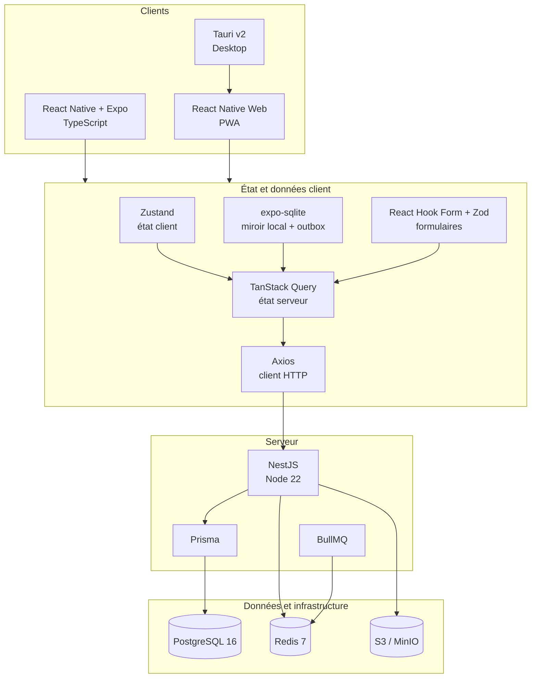
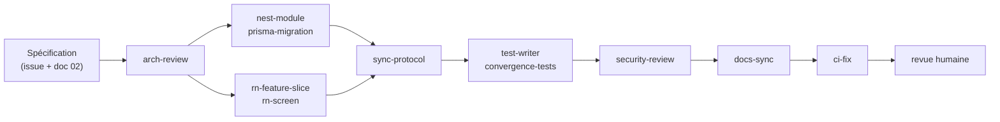

# 05 — Stack, outils, compétences et skills

> **Projet :** Focus
> **Statut :** v1.0 — référentiel technologique et catalogue de skills pour agents IA
> **Public :** architecte, développeurs, DevOps, responsables de recrutement, agents IA
> **Documents liés :** [01-ARCHITECTURE.md](./01-ARCHITECTURE.md) · [02-CAHIER-DES-CHARGES.md](./02-CAHIER-DES-CHARGES.md) · [03-DOCUMENTATION-TECHNIQUE.md](./03-DOCUMENTATION-TECHNIQUE.md) · [04-BEST-PRACTICES.md](./04-BEST-PRACTICES.md)

---

## 1. Objet

Ce document recense :

1. la **stack technologique retenue** et sa justification, y compris les technologies écartées ;
2. les **bibliothèques** par domaine ;
3. les **outils de développement** et d'exploitation ;
4. les **compétences** nécessaires, avec une matrice de niveaux ;
5. le **catalogue des skills spécialisés** destinés aux agents IA contributeurs.

Il ne remplace pas les décisions d'architecture : chaque choix renvoie à un ADR du document 01.

---

## 2. Politique de versions

| Règle | Détail |
|---|---|
| V1 | Les versions ci-dessous sont des **cibles de départ**, figées au début de la phase M0 puis verrouillées par le lockfile |
| V2 | Aucune montée de version majeure sans ADR et sans revue dédiée |
| V3 | Les correctifs de sécurité sont appliqués sous 7 jours (Renovate + revue) |
| V4 | Node est **22 LTS** ; les versions impaires (23, 25) ne sont pas supportées (ADR-016) |
| V5 | Une seule version de chaque outil dans le monorepo (pas de doublons de dépendances majeures) |
| V6 | Toute dépendance ajoutée doit être justifiée en revue (maintenance active, licence permissive, taille) |

> **Remarque d'honnêteté technique** : les numéros de version majeure évoluent vite (Expo, React, NestJS, Prisma, Zod). Les valeurs indiquées correspondent aux majeures stables au moment de la rédaction et doivent être confirmées par `pnpm outdated` lors du bootstrap M0. Ce qui est **normatif**, c'est la politique ci-dessus, pas le numéro exact.

---

## 3. Stack technologique retenue

### 3.1 Vue synthétique



### 3.2 Tableau de la stack

| Couche | Technologie | Version cible | Rôle | Justification (ADR) | Alternative écartée |
|---|---|---|---|---|---|
| Runtime | **Node.js** | 22 LTS | exécution API et tooling | support long, compatibilité Expo/Nest (ADR-016) | Node 25 (non LTS), Deno |
| Gestionnaire de paquets | **pnpm** | 9.x | monorepo | `node_modules` non plat, indispensable à React Native (ADR-001) | npm workspaces, Yarn PnP |
| Orchestrateur | **Turborepo** | 2.x | graphe de tâches, cache | cache local/CI simple | Nx (plus lourd), Lerna |
| Langage | **TypeScript** | 5.x, `strict` | tout le dépôt | contrats vérifiés à la compilation (ADR-009) | JavaScript, ReScript |
| Mobile | **React Native + Expo** | SDK stable courant | Android (+ iOS possible) | modules natifs, builds EAS, OTA (ADR-002) | RN CLI, Flutter, Kotlin natif |
| Web | **React Native Web** (export Expo) | aligné Expo | PWA | code partagé, installabilité (ADR-002/003) | Next.js, Vite + React DOM |
| Desktop | **Tauri v2** | 2.x | Windows/macOS/Linux | binaire léger, WebView système (ADR-004) | Electron, PWA seule |
| UI | **React** | 19.x (aligné Expo) | rendu | écosystème, compatibilité RN | Preact, Vue |
| Navigation | **Expo Router** | aligné Expo | routes typées, deep links | file-based, URLs web | React Navigation seul |
| État client | **Zustand** | 5.x | session, préférences, minuteur | minimal, sélecteurs granulaires (ADR-007) | Redux Toolkit, Jotai |
| État serveur | **TanStack Query** | 5.x | cache, mutations optimistes | standard de fait, offline-friendly (ADR-007) | SWR, RTK Query |
| HTTP client | **Axios** | 1.x | appels API | intercepteurs, refresh en file (ADR-008) | fetch natif |
| Formulaires | **React Hook Form** | 7.x | formulaires performants | rendus minimaux | Formik |
| Validation | **Zod** | 4.x | schémas partagés front/back | source unique de contrat (ADR-009) | Yup, Valibot |
| i18n | **i18next + react-i18next** | 24+/16+ | traduction | pluralisation, interpolation (ADR-018) | react-intl |
| Backend | **NestJS** (adaptateur Fastify) | 11.x | API modulaire | structure, DI, testabilité (ADR-005) | Express nu, Fastify nu, tRPC |
| ORM | **Prisma** | 6.x | accès PostgreSQL, migrations | typage généré, migrations lisibles (ADR-006) | Drizzle, TypeORM, Kysely |
| Base | **PostgreSQL** | 16 | persistance | relationnel + JSONB + FTS | MySQL, MongoDB |
| Cache / files | **Redis** | 7 | cache, BullMQ, rate limit, présence | polyvalence, écosystème | Memcached, pg-boss seul |
| Jobs | **BullMQ** | 5.x | rappels, push, exports | fiabilité, DLQ, jobs différés (ADR-015) | pg-boss, Agenda |
| Auth | **JWT + refresh rotatif** (implémentation maison, `@nestjs/jwt`, `argon2`) | — | sessions | contrôle total, multi-plateforme (ADR-010) | Auth0/Clerk (dépendance externe), sessions serveur pures |
| Temps réel | **Socket.IO** + adaptateur Redis | 4.x | collaboration (V1.3) | rooms, reconnexion (ADR-012) | ws nu, SSE |
| Stockage objet | **S3-compatible** (MinIO local, R2/S3 prod) | — | pièces jointes, exports | indépendance fournisseur (ADR-014) | disque local |
| Tests unitaires | **Vitest** | 3.x | unitaire + intégration | rapide, ESM natif, un seul runner | Jest |
| Composants | **React Native Testing Library** | aligné RN | tests de composants | requêtes accessibles | Enzyme |
| E2E web | **Playwright** | 1.x | parcours complets | multi-navigateurs, traces | Cypress |
| E2E mobile | **Maestro** | 1.x | parcours Android | YAML simple, pas de flakiness d'ID | Detox |
| Charge | **k6** | 1.x | tests de performance | scripts JS, métriques | Artillery |
| Lint / format | **ESLint** (config plate) + **Prettier** | 9.x / 3.x | qualité | standard | Biome (à réévaluer) |
| Logs | **pino** | 9.x | logs JSON | performant, structuré (ADR-019) | winston |
| Traces | **OpenTelemetry** | 1.x | traçage | standard ouvert | Datadog agent propriétaire |
| Erreurs | **Sentry** | SDK courant | crash reporting | source maps, releases | GlitchTip (auto-hébergé) |
| CI/CD | **GitHub Actions** | — | pipeline | intégration dépôt | GitLab CI, CircleCI |
| Builds mobile | **EAS Build / Update** | — | APK/AAB, OTA | pas de Mac nécessaire | builds locaux |
| Conteneurs | **Docker + Compose** | 24+ | environnements | reproductibilité | Podman (compatible) |

### 3.3 Technologies écartées et pourquoi

| Technologie | Raison de l'exclusion |
|---|---|
| **Next.js** | Le web est une app authentifiée sans besoin SEO ; ajouter un serveur Node pour le rendu doublerait la surface d'exploitation. Réévaluable si un site marketing public devient nécessaire (dans un dépôt séparé). |
| **GraphQL** | Client propriétaire, écrans connus, protocole de sync dédié : coût de schéma et de cache sans bénéfice (ADR-020). |
| **tRPC** | Couplerait client et serveur dans un même processus de build ; REST versionné reste nécessaire pour un futur accès public et pour la lisibilité des contrats. |
| **Electron** | Empreinte et distribution disproportionnées (ADR-004). |
| **MongoDB** | Les données sont relationnelles (workspaces → projets → tâches → tags) ; les garanties transactionnelles sont nécessaires à la sync. |
| **Redux Toolkit** | Le couple Zustand + TanStack Query couvre les besoins avec moins de code de plomberie. |
| **Jest** | Vitest offre la même API avec une configuration unique ESM/TS sur tout le monorepo. |
| **Firebase / Supabase** | Dépendance forte à un fournisseur, modèle de permissions insuffisant pour le protocole de sync, coût à l'échelle. |
| **Expo Router + Server Components** | Non mature pour un usage multiplateforme homogène à la date de rédaction ; à réévaluer. |

---

## 4. Bibliothèques par domaine

### 4.1 Client (mobile/web)

| Domaine | Bibliothèque | Usage précis |
|---|---|---|
| UI de base | `react-native`, `react-native-web` | primitives |
| Listes | `@shopify/flash-list` | listes > 50 éléments |
| Images | `expo-image` | cache disque, `blurhash` |
| Icônes | `lucide-react-native` | jeu cohérent, léger |
| Gestes | `react-native-gesture-handler`, `react-native-reanimated` | swipe, drag & drop, animations |
| Stockage sécurisé | `expo-secure-store` | refresh token (mobile) |
| Base locale | `expo-sqlite` | miroir + outbox |
| Notifications | `expo-notifications` | locales + push Android |
| Haptique | `expo-haptics` | retours tactiles discrets |
| Dates | `date-fns` + `date-fns-tz`, `Intl` | formatage localisé, fuseaux |
| Récurrence | `rrule` | génération RRULE (client et serveur) |
| Markdown | `react-native-markdown-display` (assaini) | description de tâche |
| Formulaires | `react-hook-form`, `@hookform/resolvers` | validation Zod |
| État | `zustand`, `@tanstack/react-query` | voir ADR-007 |
| Réseau | `axios` | client unique encapsulé |
| Divers | `uuid` (v7), `zod`, `i18next`, `react-i18next` | identifiants, contrats, i18n |
| Web PWA | `workbox` (via config d'export) | service worker, manifest |

### 4.2 Serveur

| Domaine | Bibliothèque | Usage précis |
|---|---|---|
| Framework | `@nestjs/core`, `@nestjs/platform-fastify` | API |
| Validation | `nestjs-zod`, `zod` | DTO partagés |
| ORM | `prisma`, `@prisma/client` | persistance |
| Auth | `@nestjs/jwt`, `argon2`, `passport-jwt` | tokens, hachage |
| Jobs | `bullmq`, `@nestjs/bullmq` | files |
| Cache | `@nestjs/cache-manager`, `ioredis` | cache membership, idempotence |
| Temps réel | `@nestjs/websockets`, `@socket.io/redis-adapter` | V1.3 |
| Fichiers | `@aws-sdk/client-s3`, `@aws-sdk/s3-request-presigner` | URLs présignées |
| E-mail | `nodemailer` + templates `mjml` | e-mails transactionnels |
| Récurrence | `rrule` | expansion des occurrences |
| Sécurité | `helmet`, `@nestjs/throttler` | en-têtes, quotas |
| Logs | `nestjs-pino`, `pino` | logs structurés |
| Observabilité | `@opentelemetry/*`, `@sentry/node` | traces, erreurs |
| Config | `@nestjs/config` + schéma Zod | validation d'environnement |

### 4.3 Partagé (`packages/contracts`)

Zod uniquement, plus des constantes et des types dérivés. **Aucune** dépendance à React, Nest ou Prisma — contrainte vérifiée en CI par une analyse des imports.

---

## 5. Outils de développement

### 5.1 Poste de travail

| Outil | Usage |
|---|---|
| VS Code | éditeur de référence ; extensions listées en doc 03 §1.2 |
| Android Studio + SDK 34 | émulateur, inspection, logs natifs |
| Expo Dev Tools / Expo Go | itération rapide |
| TablePlus / DBeaver | inspection SQL |
| RedisInsight | inspection des files et du cache |
| Postman / Bruno (collection commitée) | exploration d'API |
| Figma | design system, maquettes (source des tokens) |
| Markdown Preview + Mermaid | relecture de cette documentation |

### 5.2 Qualité et automatisation

| Outil | Rôle | Bloquant CI |
|---|---|---|
| ESLint + Prettier | style et erreurs | oui |
| `tsc --noEmit` | types | oui |
| Vitest (couverture) | tests | oui |
| Playwright | E2E web | oui sur `main` |
| Maestro | E2E mobile | non (nightly) |
| k6 | charge | non (hebdomadaire) |
| Lighthouse CI | budgets web | oui |
| `pnpm audit` | vulnérabilités | oui (high/critical) |
| Renovate | mises à jour | non (PR automatiques) |
| Sentry | erreurs runtime | non |
| OpenTelemetry + collecteur | traces | non |

### 5.3 Gestion de projet

| Outil | Usage |
|---|---|
| GitHub Issues + Projects | backlog, roadmap, bugs |
| GitHub Actions | CI/CD |
| Conventional Commits + `changesets` (si publication de paquets) | versionnement |
| Ces cinq documents | référence produit et technique |

---

## 6. Compétences nécessaires

### 6.1 Matrice de niveaux

| Niveau | Définition |
|---|---|
| **0 — Connaissance** | sait lire et comprendre le code concerné |
| **1 — Guidé** | implémente avec revue détaillée |
| **2 — Autonome** | implémente et teste seul, revoit le code des autres |
| **3 — Référent** | conçoit, arbitre, forme l'équipe |

### 6.2 Matrice par domaine

| Domaine | Compétence précise | Niveau requis (MVP) | Rôle porteur |
|---|---|---|---|
| Langage | TypeScript avancé (génériques, unions discriminées, inférence) | 3 | tous |
| Frontend | React (hooks, rendu, mémoïsation mesurée) | 3 | front |
| Mobile | React Native (cycle de vie, bridge, performance, gestes) | 2–3 | mobile |
| Mobile | Expo (config plugins, EAS, OTA) | 2 | mobile |
| Web | React Native Web, PWA, service worker | 2 | front |
| Desktop | Tauri v2, Rust de base, packaging/signature | 1–2 (V1.1) | desktop |
| État | TanStack Query (cache, invalidation, mutations optimistes) | 3 | front |
| État | Zustand (sélecteurs, persistance) | 2 | front |
| Formulaires | React Hook Form + Zod | 2 | front |
| Backend | NestJS (modules, DI, guards, pipes, filtres) | 3 | back |
| Backend | Conception d'API REST, versionnement, idempotence | 3 | back |
| Données | PostgreSQL (index, plans, transactions, isolation) | 3 | back |
| Données | Prisma (schéma, migrations, requêtes brutes maîtrisées) | 2–3 | back |
| Asynchrone | BullMQ, idempotence des jobs, DLQ | 2 | back |
| Sécurité | OWASP, JWT/refresh, Argon2, cloisonnement multi-tenant | 3 | back |
| Sync | Protocoles de synchronisation, résolution de conflits | 3 | architecte |
| Tests | Tests unitaires, intégration, E2E, tests de convergence | 2–3 | tous |
| UI/UX | Design system, accessibilité WCAG 2.2 AA, microcopy | 2 | design + front |
| DevOps | Docker, CI/CD, migrations en production, observabilité | 2–3 | DevOps |
| Produit | Priorisation, rédaction de critères d'acceptation | 2 | PO |

### 6.3 Répartition minimale d'une équipe de démarrage

| Rôle | Effectif | Responsabilités |
|---|---|---|
| Architecte / tech lead | 1 | ADR, protocole de sync, revue transverse |
| Développeur backend | 1–2 | NestJS, Prisma, auth, jobs |
| Développeur frontend/mobile | 2 | Expo, design system, vues |
| Designer produit | 0,5 | identité, tokens, maquettes, accessibilité |
| DevOps (partagé) | 0,3 | CI/CD, environnements, supervision |

### 6.4 Plan de montée en compétence (4 semaines)

| Semaine | Thème | Livrable de validation |
|---|---|---|
| 1 | TypeScript strict + architecture du monorepo | un module de bout en bout (contrat → API → écran) |
| 2 | Protocole de sync et offline | les 7 scénarios SYNC-01..07 passent |
| 3 | Design system et accessibilité | audit clavier + contraste sur deux écrans |
| 4 | Tests, CI, observabilité | une feature livrée avec tests, trace et dashboard |

---

## 7. Catalogue des skills pour agents IA

### 7.1 Format d'un skill

Un skill est un fichier Markdown (ou un dossier `SKILL.md` + ressources) placé dans `.freebuff/skills/<nom>/SKILL.md`, versionné avec le code. Il contient un en-tête structuré puis des instructions exécutables.

```markdown
---
name: nest-module
description: Créer ou modifier un module NestJS conforme à l'architecture Focus (controller, service, repository, contrats Zod, tests).
when_to_use: Ajout d'une ressource API, d'un cas d'usage ou d'un endpoint.
inputs:
  - nom du domaine (ex. habits)
  - opérations à exposer
  - schémas Zod concernés
outputs:
  - fichiers créés/modifiés
  - tests unitaires + intégration
  - entrée openapi.json régénérée
tools:
  - read, write, edit, bash
guardrails:
  - ne jamais exposer PrismaService dans un controller
  - toute mutation écrit un SyncChange dans la même transaction
  - workspaceId dérivé du contexte, jamais du corps de requête
references:
  - docs/01-ARCHITECTURE.md §8
  - docs/04-BEST-PRACTICES.md §6
verification:
  - pnpm --filter @focus/api typecheck
  - pnpm --filter @focus/api test
---

## Procédure
1. ...
2. ...
```

### 7.2 Conventions du catalogue

| Élément | Convention |
|---|---|
| Nom | `kebab-case`, préfixe par domaine (`rn-`, `nest-`, `sync-`, `doc-`) |
| Portée | un skill = une tâche répétable, pas un domaine entier |
| Taille | instructions < 150 lignes, exemples inclus ; au-delà, découper |
| Dépendances | un skill peut en appeler un autre explicitement (section « Skills liés ») |
| Vérification | tout skill se termine par une commande de vérification exécutable |
| Interdits | un skill ne pousse jamais sur `main`, ne déploie pas, ne modifie pas `.env` |

### 7.3 Catalogue

#### A. Architecture et documentation

| ID | Skill | Déclencheur | Entrées | Sorties | Vérification |
|---|---|---|---|---|---|
| `arch-adr` | `adr-writer` | décision structurante | contexte, options, décision | nouvel ADR + mise à jour de l'index | cohérence des numéros, liens valides |
| `arch-review` | `architecture-review` | avant merge d'une feature transversale | diff, ADR concernés | rapport de conformité | checklist doc 01 §6.2 |
| `doc-sync` | `docs-sync` | le code change un contrat, un port, une variable d'env | diff | mise à jour ciblée des 5 documents | `grep` des valeurs obsolètes |
| `doc-diagram` | `mermaid-diagram` | besoin d'un nouveau diagramme | description du flux | bloc Mermaid validé | rendu sans erreur de syntaxe |

#### B. Backend

| ID | Skill | Déclencheur | Entrées | Sorties | Vérification |
|---|---|---|---|---|---|
| `nest-module` | `nest-module` | nouvelle ressource API | domaine, opérations | module complet (controller/service/repository/contrats/tests) | typecheck + tests |
| `nest-migration` | `prisma-migration` | évolution du modèle | description du changement | `schema.prisma`, migration SQL lue, index | `prisma migrate dev` + tests d'intégration |
| `nest-guard` | `authz-policy` | nouvelle route protégée | ressource, rôles | guard + policy + tests négatifs | tests d'accès croisé |
| `nest-job` | `bullmq-job` | traitement asynchrone | déclencheur, idempotence | processor + enqueue + test de rejeu | test d'idempotence (double exécution) |
| `nest-error` | `problem-details` | nouvelle erreur métier | code, statut, clé i18n | `DomainError` + mapping + doc | test de format RFC 9457 |
| `sync-endpoint` | `sync-protocol` | évolution du pull/push | entité, champs versionnés | handler, journal, résolution | scénarios SYNC-01..07 |

#### C. Frontend / mobile

| ID | Skill | Déclencheur | Entrées | Sorties | Vérification |
|---|---|---|---|---|---|
| `rn-screen` | `rn-screen` | nouvel écran | intention, données, états | route Expo Router + composants + états (4) | rendu + a11y |
| `rn-feature` | `rn-feature-slice` | nouvelle feature verticale | domaine | `features/<domaine>` complet | typecheck + tests |
| `rn-form` | `rhf-zod-form` | formulaire | champs, règles | formulaire RHF + schéma partagé + erreurs i18n | tests de validation |
| `rn-list` | `virtualized-list` | liste longue | forme des items | FlashList + clés stables + états | profilage 1 000 items |
| `rn-a11y` | `a11y-audit` | avant release d'un écran | écran | rapport + correctifs | checklist WCAG (doc 04 §11.3) |
| `rn-i18n` | `i18n-extract` | ajout de textes | diff | clés `fr`/`en`, aucun littéral | script de parité des catalogues |
| `rn-offline` | `offline-first` | lecture/écriture de données | entité | repository SQLite + outbox | test hors ligne |
| `design-token` | `design-token-usage` | nouveau composant visuel | intention | composant `packages/ui` utilisant les tokens | lint « pas de couleur littérale » |
| `desktop-tauri` | `tauri-capability` | capacité native desktop | besoin (tray, autostart) | configuration + commande Rust minimale | build local + revue de la CSP |

#### D. Qualité, sécurité, performance

| ID | Skill | Déclencheur | Entrées | Sorties | Vérification |
|---|---|---|---|---|---|
| `qa-unit` | `test-writer` | comportement non couvert | fonction/feature | tests unitaires pertinents | mutation testing manuel sur 3 cas |
| `qa-sync` | `convergence-tests` | modification du protocole | scénario | tests multi-clients | état final identique |
| `qa-e2e` | `playwright-scenario` | parcours critique | parcours | test E2E + fixtures | exécution locale headless |
| `sec-audit` | `security-review` | nouvelle route ou upload | diff | rapport STRIDE + correctifs | checklist doc 04 §7.1 |
| `perf-api` | `api-perf-check` | endpoint lent | endpoint | plan d'exécution, index, mesure avant/après | k6 + `EXPLAIN ANALYZE` |
| `perf-web` | `web-budget` | avant release web | build | rapport Lighthouse + actions | seuils doc 02 §7.1 |

#### E. Livraison

| ID | Skill | Déclencheur | Entrées | Sorties | Vérification |
|---|---|---|---|---|---|
| `rel-ci` | `ci-fix` | pipeline rouge | logs | correctif minimal de la cause | pipeline verte |
| `rel-mobile` | `eas-release` | publication Android | version, notes | build EAS + artefact | APK installable sur appareil |
| `rel-desktop` | `tauri-release` | publication desktop | version, OS cible | bundles signés | installation sur VM propre |
| `rel-migrate` | `safe-migration` | migration risquée | changement | plan expand/contract + rollback | test sur copie staging |
| `rel-incident` | `runbook-execute` | incident | symptômes | diagnostic guidé + actions | vérification post-action |

### 7.4 Skills prioritaires pour le démarrage (M0–M1)

| Ordre | Skill | Justification |
|---|---|---|
| 1 | `nest-module` | produit l'ossature de tous les modules |
| 2 | `prisma-migration` | évite les migrations destructrices dès le début |
| 3 | `rn-screen` + `rn-feature-slice` | accélère les vues MVP |
| 4 | `sync-protocol` + `convergence-tests` | risque technique principal |
| 5 | `a11y-audit` | l'accessibilité se construit, elle ne se rattrape pas |
| 6 | `docs-sync` | garantit la cohérence de ces cinq documents |
| 7 | `test-writer` | maintient la couverture du domaine |

### 7.5 Exemple complet de skill

```markdown
---
name: sync-protocol
description: Faire évoluer le protocole de synchronisation (pull/push) sans casser la convergence multi-appareils.
when_to_use: Ajout d'un champ synchronisé, d'une entité, ou modification de la résolution de conflits.
inputs: entité concernée, champs, stratégie de conflit attendue
outputs: migration, journal, handler, tests de convergence, mise à jour doc 01 §11
tools: read, write, edit, bash
guardrails:
  - toute écriture passe par une transaction incluant l'insertion SyncChange
  - jamais de suppression physique sans tombstone
  - le curseur reste monotone et global au workspace
  - aucune résolution de conflit côté client sans validation serveur
verification:
  - pnpm --filter @focus/api test:integration -- sync
  - pnpm test:e2e:web --grep "sync"
---

## Procédure
1. Identifier l'entité et les champs concernés dans `schema.prisma`.
2. Vérifier que `version` est incrémentée sur chaque écriture serveur.
3. Ajouter l'entrée dans `SyncChange` (payload minimal, jamais l'entité complète).
4. Mettre à jour le schéma Zod du push (`baseVersion` obligatoire pour UPDATE/DELETE).
5. Écrire les scénarios SYNC-01..07 impactés.
6. Mesurer le volume du journal (index `(workspaceId, id)`).
7. Mettre à jour `docs/01-ARCHITECTURE.md` §11 et `docs/03` §8.3.

## Critères de refus
- Tests de convergence non écrits.
- Champ ajouté côté client sans équivalent serveur.
- Résolution de conflit implicite non documentée.
```

### 7.6 Orchestration multi-skills



| Règle d'orchestration | Détail |
|---|---|
| O1 | Un agent ne fusionne jamais sur `main` sans revue humaine |
| O2 | Un agent n'exécute pas de déploiement en production |
| O3 | Un agent ne modifie pas les secrets ni les fichiers d'environnement |
| O4 | Toute modification de migration ou de protocole de sync exige une validation humaine explicite |
| O5 | Un agent doit citer les fichiers qu'il a modifiés et les vérifications exécutées |
| O6 | En cas de conflit entre un skill et ces cinq documents, **les documents font foi** |

### 7.7 Garde-fous et limites des agents IA

| Risque | Mesure |
|---|---|
| Hallucination d'API ou de bibliothèque | vérification dans `node_modules`/documentation avant usage ; pas de dépendance inventée |
| Refactor massif non demandé | périmètre limité au diff demandé (doc 04 §1.1) |
| Tests affaiblis pour faire passer la CI | revue humaine obligatoire sur tout changement de test |
| Fuite de secret | aucun accès aux fichiers `.env` ; secrets uniquement par l'environnement |
| Régression de performance | mesure avant/après obligatoire pour tout `perf` |
| Documentation divergente | skill `docs-sync` déclenché à chaque changement de contrat |
| Suppression de données | interdiction de toute commande destructive (`db:reset` réservé au local, jamais exécuté par un agent sur staging/prod) |

### 7.8 Indicateurs de qualité des contributions IA

| Indicateur | Cible |
|---|---|
| PR IA acceptées sans reprise majeure | ≥ 70 % |
| PR IA avec tests associés | 100 % |
| Régressions introduites par PR IA (30 j) | ≤ 5 % |
| Temps de revue médian d'une PR IA | ≤ 20 min |
| Occurrences de secrets/`any` détectées en revue | 0 |

---

## 8. Annexes

### 8.1 Correspondance skills ↔ documents

| Skill | Document de référence |
|---|---|
| `adr-writer`, `architecture-review` | 01 §5, §6 |
| `nest-module`, `authz-policy` | 01 §8, 04 §6–7 |
| `prisma-migration` | 01 §9, 03 §5 |
| `sync-protocol`, `convergence-tests` | 01 §11, 03 §8.3 |
| `rn-screen`, `rn-feature-slice`, `offline-first` | 01 §7, 04 §4–5 |
| `a11y-audit`, `design-token-usage` | 04 §11 |
| `docs-sync` | 02 §13, 03 §13 |
| `eas-release`, `tauri-release`, `safe-migration` | 03 §9 |
| `security-review` | 01 §15, 04 §7 |
| `api-perf-check`, `web-budget` | 01 §16, 02 §7.1 |

### 8.2 Modèle de fiche de compétence (pour recrutement)

```markdown
## Compétence : <nom>
- Niveau attendu : 0–3
- Preuves observables : <exemples concrets>
- Évaluation : <exercice ou entretien technique>
- Formation interne : <ressource, durée>
- Skills IA associés : <ids>
```

### 8.3 Glossaire

| Terme | Définition |
|---|---|
| **Skill** | Procédure versionnée, exécutable par un agent IA, avec entrées, sorties et vérifications |
| **Garde-fou** | Contrainte explicite qu'un agent ne peut pas franchir |
| **ADR** | Architecture Decision Record — décision structurante datée |
| **Outbox** | File locale des mutations non confirmées |
| **Convergence** | Propriété d'un système de sync où tous les clients aboutissent au même état |
| **Budget** | Seuil mesurable bloquant en CI (performance, taille, accessibilité) |

---

**Fin du document 05.**
